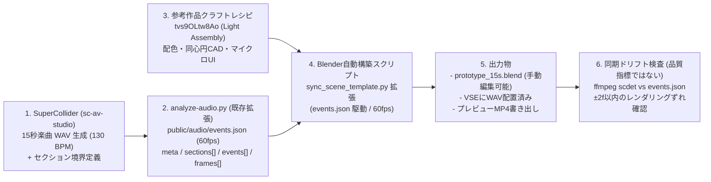

# 15秒 音楽×映像 同時自動生成 試作計画（改訂版 v3）

> **目的**: `sc-av-studio`（SuperCollider音楽生成＋既存60fps同期基盤）と `iketeru-eizou` のクラフトレシピを接続し、**15秒の作品を1本、Blender で手動編集可能な `.blend` プロジェクトとして自動生成する**最小試作（MVP）の計画書です。
> **ステータス**: 計画のみ（ユーザー承認後に実装着手）

---

## 1. 改訂ポイント（外部レビュー第2回・第3回反映）

1. **既存同期基盤の流用・時刻データ一本化**:
   - `E:\sc-av-studio\blender\sync_scene_template.py` と `public/audio/events.json`（60fps）を土台にし、新しい `master_timeline.json` は作らない。
   - **セクション区切り時刻を計画書に直書きしない**: 音楽側（`sc-av-studio`）が `events.json` 内に `sections[]`（`intro` / `build` / `drop` / `outro` の `startFrame`・`endFrame`）を書き出し、Blender スクリプトはそれを動的に読み込む。
2. **具体的な参考作品を1本に確定（非暫定・v2クラフトレシピ保有作）**:
   - **`Light Assembly`**（YouTube ID: `tvs9OLtw8Ao` / 総合 `S-`・演出 `A+`・技術 `S` / 暫定評価ではない本分析済み作品）を唯一の参考作品とする。
3. **動き・同期計測の位置づけ明確化**:
   - オプティカルフローによるイージング推定は除外する。
   - `ffmpeg scdet` によるカット点検出と `events.json` ビート一致率の計測は、作り方からして高くなるため**品質の指標ではない**。あくまで **「レンダリングやフレーム変換で音と映像がずれていないかの確認（同期ドリフト検査）」** として位置づける。
4. **第1弾を Blender に統一＋品質判定チェックリスト追加**:
   - 操作性チェック（テキスト・色・タイミング・音量の変更）に加え、**参考作品と並べて見比べた上でのユーザー品質判定（「使える／使えない」と理由の記録）** を必須完了条件とする。

---

## 2. アーキテクチャ（`events.json` 1本同期）



### `events.json` スキーマ（音楽側が出力する唯一の時刻データ）
```json
{
  "meta": { "fps": 60, "bpm": 130, "totalFrames": 900 },
  "sections": [
    { "name": "intro", "startFrame": 1, "endFrame": 166 },
    { "name": "build", "startFrame": 167, "endFrame": 443 },
    { "name": "drop",  "startFrame": 444, "endFrame": 720 },
    { "name": "outro", "startFrame": 721, "endFrame": 900 }
  ],
  "events": [
    { "type": "kick", "frame": 1, "velocity": 0.92 },
    { "type": "snare", "frame": 28, "velocity": 0.85 }
  ],
  "frames": [
    { "frame": 1, "low": 0.81, "mid": 0.24, "high": 0.12 }
  ]
}
```
※ 上記 `startFrame` / `endFrame` は130BPM時の例示であり、実際の境界フレームは楽曲生成時に音楽側（`sc-av-studio`）が小節境界から算出して `events.json` に書き出す。Blender 側に秒数・フレーム数をハードコードしない。

---

## 3. 参考作品とクラフトレシピ→Blenderパラメータ対応表

- **参考作品**: **`Light Assembly`**（ID: `tvs9OLtw8Ao` / `https://www.youtube.com/watch?v=tvs9OLtw8Ao` / 総合 `S-`・演出 `A+`・技術 `S` / 非暫定・v2クラフトレシピ保有）
- **参照カット**: Cut #01「精密青CAD同心円ワイヤー×赤橙回折モアレ＆露出『+0.5』マイクロUI切替」

| クラフトレシピ項目（`tvs9OLtw8Ao`） | レシピ上の値・設計意図 | Blender 側の対応パラメータ |
|---|---|---|
| `color_palette_hex.base` | `#081838`（全編固定の暗紺背景） | `World.node_tree.nodes["Background"].inputs["Color"]` = `(0.031, 0.094, 0.220, 1.0)`（全セクション固定） |
| `color_palette_hex.primary` / `accent` | `#1848A8` / `#183888`（CAD同心円コバルト青）＋赤橙回折ハイライト | `Mat_CAD_Blue`（Principled BSDF / Emission `#1848A8`）および `Mat_Diffraction_Orange`（Emission `#FF5A1F`、Add/Mix強度を `events.json` の `high` に連動） |
| `layer_stack[1]`（CAD Concentric Lens & Diffraction） | 2組の等間隔同心円ワイヤーを微小オフセットして干渉モアレを生成 | `03_Hero_Geometry` 内の2組の Curve Circle 配列（`RingGroup_A` / `RingGroup_B`、Bevel Depth = `0.004` の極細線、`RingGroup_B.location.x` を `frames[].mid` に連動オフセット） |
| `layer_stack[2]`（Minimalist Micro-UI Scale） | 高密度状態から一点、中央の極小フラット白UI（`+0.5` 露出目盛り）へ引き算 | `02_Typography` 内の Font Object（`Text_MicroUI` = `"+0.5"`、`Mat_UI_White` Emission `#FFFFFF`）。`sections` の `outro` 開始フレームで `RingGroup` を非表示（`hide_render` / `scale=0`）にして中央UIのみへ切替 |
| `easing_and_timing.bpm` & `audio_sync_cues` | 130BPM のクリック／サイン波拍頭での1フレーム誤差なし同期 | `sc-av-studio` 楽曲BPMを 130 に合わせ、`events[]`（`kick`/`snare`）フレームにカメラ切替 `timeline_markers` と `RingGroup` スケールキーフレーム（Interpolation = `CONSTANT` / `EXPO`）を配置 |
| `easing_and_timing.hold_frames` | `hold_frames: 2`（切替直後の2フレーム静止でキレを出す） | キーフレーム打鍵後、`frame + 2` まで値を保持するホールドキーフレームを挿入 |
| `anti_ai_slop_notes` | 適当なSF風HUDゲージを排し、光学レンズ・露出目盛り由来の図形のみで構成 | 余計なランダムパーティクルや装飾テキストを置かず、同心円＋光軸十字線＋露出目盛りテキストの3要素のみに絞る |

---

## 4. セクション構成（`events.json` の `sections[]` 駆動）

| `sections[].name` | 参照する `events.json` 要素 | Blender シーン挙動（すべて手動編集可能） |
|---|---|---|
| `intro` | `startFrame..endFrame`, `kick` | 暗紺背景（`#081838`）に `RingGroup_A` が `kick` 拍頭で段階出現＋`Text_Title`（Font Object）表示 |
| `build` | `startFrame..endFrame`, `kick`/`snare`, `low`/`mid` | `RingGroup_B` を重ねて微小オフセット開始（回折モアレ発生）、カメラを `Cam_02_Angle` へ切替 |
| `drop` | `startFrame..endFrame`, `kick`/`snare`, `high` | 高密度同心円＋赤橙回折ハイライト発光ピーク、`kick`/`snare` 拍頭で `Cam_03` / `Cam_04` を切替 |
| `outro` | `startFrame..endFrame` | 全高密度ワイヤーを一瞬で引き算し、中央の極小UI（`Text_MicroUI` = `"+0.5"`）とタグラインのみ表示、VSE音声フェードアウト |

---

## 5. 同期ドリフト検査（品質指標ではない）

- **目的**: Blender で `events.json` 通りに組んだカット点が、MP4 書き出し・音声エンコード後にずれていないかを確認する**技術的な整合チェック**（作り方からして一致率は高くなるため、映像クオリティの評価指標には使わない）。
- **手順**:
  1. 書き出した15秒MP4に `ffmpeg -vf scdet=threshold=10` を実行し、実測カットフレームを取得する。
  2. `events.json` のカメラ切替対象 `events[]` フレームとの差分を計算し、誤差 `±2フレーム（±33ms）` 以内に収まっているかをログ出力する。
  3. 3フレーム以上のずれが出た場合は、レンダリング設定（fps・音声オフセット・VSE配置）のバグとして修正する。

---

## 6. 実装ステップ（承認後に着手）

1. **Step 1**: `sc-av-studio` で 130 BPM・15秒の楽曲 WAV と、`sections[]` を含む `public/audio/events.json`（60fps）を1セット生成する。
2. **Step 2**: `E:\sc-av-studio\blender\sync_scene_template.py` を拡張し、`tvs9OLtw8Ao` のパラメータ対応表と `events.json` の `sections[]` を読み込む `prototype_15s_generator.py` を作成する。
3. **Step 3**: Blender CLI（`blender --background --python ...`）で `prototype_15s.blend` とプレビュー MP4 を書き出す。
4. **Step 4**: `ffmpeg scdet` でレンダリングの同期ドリフト検査を実行する。
5. **Step 5**: ユーザーが実物（MP4 + `.blend`）を参考作品 `Light Assembly` と並べて確認し、下記チェックリストで合否を判定する。

---

## 7. 成功の判定基準（チェックリスト）

### A. 技術・編集性チェック（Blender 上での手動調整）
- [ ] **Blender起動**: 生成された `prototype_15s.blend` をユーザーの Blender でエラーなく開ける
- [ ] **テキスト変更**: `02_Typography` の Font Object（タイトル／`+0.5` UI）の文字を書き換えられる
- [ ] **色変更**: `Mat_CAD_Blue` / `Mat_Diffraction_Orange` / World 背景色を Blender 上で変更できる
- [ ] **タイミング変更**: カメラ切替マーカーまたはキーフレームを移動してタイミングを変更できる
- [ ] **音量変更**: Video Sequencer（VSE）上の WAV ストリップ音量を変更し、音付きで再書き出しできる
- [ ] **同期ドリフト検査**: `ffmpeg scdet` と `events.json` のカメラ切替フレームのずれが `±2フレーム` 以内である（レンダリングずれが無いことの確認）

### B. 品質判定チェック（ユーザーによる実物評価）
- [ ] **参考作品との比較判定**: 参考作品 `Light Assembly`（`tvs9OLtw8Ao`）と書き出しMP4を並べて見比べ、ユーザーが **「使える／使えない」** を判定し、その理由を記録する
- [ ] **ギャップ記録**: 色・密度の引き算・拍頭キレ・音の噛み合いの4観点で、参考作品に近い点と不足している点をメモし、次イテレーションの改善項目を確定する
