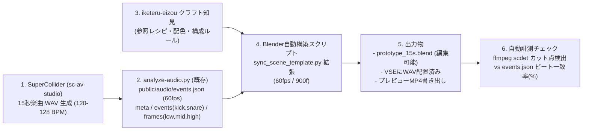

# 15秒 音楽×映像 同時自動生成 試作計画（改訂版 v2）

> **目的**: `sc-av-studio`（SuperCollider音楽生成＋既存60fps同期基盤）と `iketeru-eizou` の分析知見を接続し、**15秒の作品を1本、Blender で手動編集可能な `.blend` プロジェクトとして自動生成する**最小試作（MVP）の計画書です。
> **ステータス**: 計画のみ（ユーザー承認後に実装着手）

---

## 1. 改訂ポイント（外部レビュー第2回反映）

1. **既存同期基盤の流用・時刻データ一本化**:
   - `E:\sc-av-studio\blender\sync_scene_template.py` と `public/audio/events.json`（60fps）をそのまま土台にする。
   - 新しい `master_timeline.json` は**作らない**。音楽側が生成する `events.json` 1本を唯一の時刻・イベント定義ソース（Single Source of Truth）とする。
2. **動き解析スコープの縮小（過大設計の排除）**:
   - オプティカルフローによるイージング推定は**試作範囲から除外**する。
   - 映像リズム検証は **①カット点検出（`ffmpeg scdet`）** と **②カット点とビートの一致率計測（`events.json` との誤差±2フレーム以内率）** の2項目のみに絞る。
3. **第1弾ターゲットを Blender に統一**:
   - After Effects（.jsx）連携は第2弾以降とし、第1弾は既存テンプレートのある **Blender（`.blend` 生成）** に集中する。

---

## 2. アーキテクチャ（`events.json` 1本同期）

### 使用する `events.json` の既存構造（`E:\sc-av-studio\blender\sync_scene_template.py` 準拠）
- `meta.fps`: `60`
- `meta.totalFrames`: `900`（15秒 × 60fps）
- `events[]`: `{ "type": "kick" | "snare", "frame": int, "velocity": float }`
- `frames[]`: `{ "frame": int, "low": float, "mid": float, "high": float }`

---

## 3. 15秒（900フレーム @ 60fps）構成案

| セクション | 時間 | フレーム | 音楽展開 (`events.json`) | Blenderシーン表現（すべて手動編集可能オブジェクト） |
|---|---|---|---|---|
| **Hook** | 0.0s – 3.0s | `1 – 180` | イントロ・キック立ち上がり | タイトルテキスト（Font Object）＋メインシェイプ出現（`kick`イベントでスケールキーフレーム） |
| **Build** | 3.0s – 7.5s | `181 – 450` | キック＋スネア加速 | カメラワーク切替（複数Camera＋Markerバインド）＋`low/mid/high`連動ジオメトリ＆ライト強度 |
| **Drop / Climax** | 7.5s – 12.5s | `451 – 750` | 最大エネルギー・ビート刻み | 高密度カット切替（`kick`/`snare`フレームにカメラ切替Marker配置）＋カラーマテリアル切替 |
| **Outro / Tagline** | 12.5s – 15.0s | `751 – 900` | 余韻・フェードアウト | タグラインテキスト表示＋カメラ静止＋VSEオーディオフェードアウト |

---

## 4. Blender プロジェクト編集性設計（手動調整の保証）

`sync_scene_template.py` を拡張し、生成される `.blend` ファイルを以下のコレクション・構造で整理する：

- **`01_Cameras`**: カットごとのカメラ（`Cam_01_Hook` 等）をタイムラインマーカーでバインド（タイミング変更＝マーカーをドラッグするだけ）
- **`02_Typography`**: メッシュ化していない **Blender標準 Font Object**（`Text_Title`, `Text_Tagline`）として配置（Tabキーで文字列を直接編集可能）
- **`03_Hero_Geometry`**: 編集可能なモディファイア・マテリアル付きオブジェクト（色変更＝Principled BSDF の Base Color / Emission Color を変えるだけ）
- **`04_Lighting`**: キーライト・リムライト・背景ワールドカラー
- **Video Sequencer (VSE)**: 生成した15秒 WAV を Sound Strip としてフレーム1に配置（音量変更＝VSEストリップの Volume スライダーで直接調整可能）

---

## 5. 動き・リズム検証（試作スコープ限定）

試作フェーズでは以下2点のみを自動計測する（オプティカルフローによるイージング推定は行わない）：

1. **カット点検出（`ffmpeg scdet`）**:
   - 書き出した15秒プレビューMP4に対し `ffmpeg -vf scdet=threshold=10` で実測カット時刻（フレーム）を抽出する。
2. **カットとビートの一致率計測**:
   - `scdet` で検出された各カットフレームと、`events.json` の `events[]`（`kick`/`snare`）フレームの最小距離を計算する。
   - 誤差 `±2フレーム（±33ms）` 以内に収まったカットの割合（%）を算出し、ログ出力する。

---

## 6. 実装ステップ（承認後に着手）

1. **Step 1**: `sc-av-studio` で 15秒（900f @ 60fps）の楽曲 WAV と `public/audio/events.json` を1セット生成する。
2. **Step 2**: `E:\sc-av-studio\blender\sync_scene_template.py` をベースに、4セクション構成・編集可能テキスト・カメラマーカー・VSE音声配置を備えた `prototype_15s_generator.py` を作成する。
3. **Step 3**: Blender CLI（`blender --background --python ...`）で `prototype_15s.blend` とプレビュー MP4 を書き出す。
4. **Step 4**: `ffmpeg scdet` でカット点と `events.json` のビート一致率（%）を計測する。
5. **Step 5**: ユーザーが実物（MP4 + `.blend`）を確認し、下記チェックリストで合否を判定する。

---

## 7. 成功の判定基準（チェックリスト）

試作の完了は、以下のチェック項目を**ユーザー自身の手で確認**できた時点とする：

- [ ] **試聴・評価**: 書き出された15秒プレビューMP4をユーザーが視聴し、音楽と映像の同期感・クオリティを評価できる
- [ ] **Blender起動**: 生成された `prototype_15s.blend` をユーザーの Blender でエラーなく開ける
- [ ] **テキスト変更**: `02_Typography` のテキストオブジェクトの文字を Blender 上で書き換えられる
- [ ] **色変更**: マテリアル（Base Color / Emission）またはワールド背景色を Blender 上で変更できる
- [ ] **タイミング変更**: カメラ切替マーカーまたはキーフレームをタイムライン上で移動し、カット・動きのタイミングを変更できる
- [ ] **音量変更**: Video Sequencer（VSE）上の音声ストリップの音量を変更し、音付きで再書き出しできる
- [ ] **自動計測**: `ffmpeg scdet` によるカット検出と `events.json` とのビート一致率（%）が算出されている
