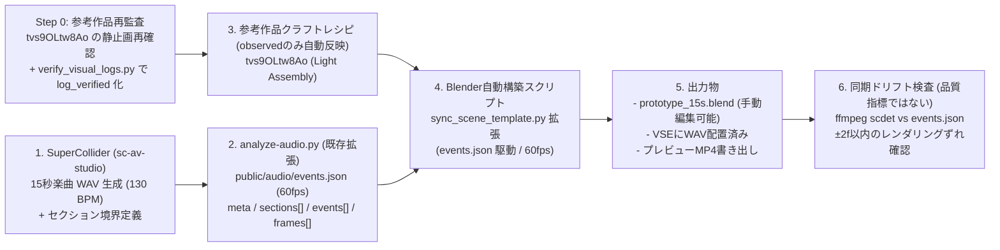

# 15秒 音楽×映像 同時自動生成 試作計画（改訂版 v4）

> **目的**: `sc-av-studio`（SuperCollider音楽生成＋既存60fps同期基盤）と `iketeru-eizou` のクラフトレシピを接続し、**15秒の作品を1本、Blender で手動編集可能な `.blend` プロジェクトとして自動生成する**最小試作（MVP）の計画書です。
> **ステータス**: 計画のみ（ユーザー承認後に Step 0 から着手）

---

## 1. 改訂ポイント（外部レビュー第2回〜第4回反映）

1. **既存同期基盤の流用・時刻データ一本化**:
   - `E:\sc-av-studio\blender\sync_scene_template.py` と `public/audio/events.json`（60fps）を土台にし、新しい `master_timeline.json` は作らない。
   - **セクション区切り時刻を計画書に直書きしない**: 音楽側（`sc-av-studio`）が `events.json` 内に `sections[]`（`intro` / `build` / `drop` / `outro` の `startFrame`・`endFrame`）を書き出し、Blender スクリプトはそれを動的に読み込む。
2. **参考作品のステータスを事実通りに明記し、試作前の再監査を前提化（#6）**:
   - 参考作品は **`Light Assembly`**（YouTube ID: `tvs9OLtw8Ao` / 総合 `S-`・演出 `A+`・技術 `S`）とする。
   - 現在のステータスは **`analysisStatus: full_analysis`（非暫定）** だが、**`visualVerificationStatus: unverifiable_no_log`（過去ログ非残存のため確認不能）** である。
   - したがって、**Step 0 として試作着手前に `tvs9OLtw8Ao` の静止画コンタクトシート再監査＋`verify_visual_logs.py` による `log_verified` 昇格を完了させる**ことを必須前提とする。
3. **実測値（`observed`）と推測値（`inferred`）の厳密な分離（#7）**:
   - パラメータ対応表の各行に元データの根拠（実測 `observed` / 推測 `inferred`）を明記する。
   - 推測値である **Cut #4 のイージング（`0/95->0/8`, `verified: false`）** および **全カットの `transition_bridge`（`source: inferred`）** はスクリプトへ自動焼き込みせず、**試作時にユーザーが Blender 上で手動調整する項目**として扱う。
4. **同期ドリフト検査の位置づけ明確化（#8）**:
   - オプティカルフローによるイージング推定は除外する。
   - `ffmpeg scdet` によるカット点検出と `events.json` ビート一致率の計測は、作り方からして高くなるため**品質の指標ではない**。あくまで **「レンダリングやフレーム変換で音と映像がずれていないかの確認（同期ドリフト検査）」** として位置づける。
5. **第1弾を Blender に統一＋品質判定チェックリスト（#11）**:
   - 操作性チェック（テキスト・色・タイミング・音量の変更）に加え、**参考作品と並べて見比べた上でのユーザー品質判定（「使える／使えない」と理由の記録）** を必須完了条件とする。

---

## 2. アーキテクチャ（`events.json` 1本同期）



### `events.json` スキーマ（音楽側が出力する唯一の時刻データ）
```json
{
  "meta": { "fps": 60, "bpm": 130, "totalFrames": 900 },
  "sections": [
    { "name": "intro", "startFrame": 1, "endFrame": 166 },
    { "name": "build", "startFrame": 167, "endFrame": 443 },
    { "name": "drop",  "startFrame": 444, "endFrame": 720 },
    { "name": "outro", "startFrame": 721, "endFrame": 900 }
  ],
  "events": [
    { "type": "kick", "frame": 1, "velocity": 0.92 },
    { "type": "snare", "frame": 28, "velocity": 0.85 }
  ],
  "frames": [
    { "frame": 1, "low": 0.81, "mid": 0.24, "high": 0.12 }
  ]
}
```
※ 上記のフレーム番号は例示であり、実際の境界フレームは音楽側（`sc-av-studio`）が小節境界から算出して `events.json` に書き出す。Blender 側に秒数・フレーム数をハードコードしない。

---

## 3. 参考作品とクラフトレシピ→Blenderパラメータ対応表（実測／推測を明記）

- **参考作品**: **`Light Assembly`**（ID: `tvs9OLtw8Ao` / `https://www.youtube.com/watch?v=tvs9OLtw8Ao` / 総合 `S-`・演出 `A+`・技術 `S`）
- **現在の検証状態**: `analysisStatus: full_analysis`（非暫定）／ **`visualVerificationStatus: unverifiable_no_log`**（→ **Step 0 で静止画再監査＋ログ照合により `log_verified` にしてから試作に着手する**）

### A. 自動スクリプトへ反映する項目（元データの根拠を明記）

| クラフトレシピ項目（`tvs9OLtw8Ao` Cut #01） | 元データの値・内容 | 根拠（実測／推測） | Blender 側の対応パラメータ |
|---|---|---|---|
| `media.telemetry.palette_hex.base` | `#081838`（暗紺背景） | **実測 (`observed`)**（フレーム35枚のピクセル集計） | `World.node_tree.nodes["Background"].inputs["Color"]` = `(0.031, 0.094, 0.220, 1.0)` |
| `media.telemetry.palette_hex.primary` / `accent` | `#1848A8` / `#183888`（CADコバルト青） | **実測 (`observed`)**（フレーム35枚のピクセル集計） | `Mat_CAD_Blue`（Principled BSDF / Emission `#1848A8`） |
| `media.telemetry.luminance` | `mean=54.3`, `is_low_key=true`, `contrast_range=76.7` | **実測 (`observed`)**（輝度ヒストグラム実測） | 低キー暗紺空間の露出基準（Color Management: `AgX`, `Exposure = 0.0`、発光マテリアルのみ高コントラスト） |
| `easing_and_timing`（Cut #01） | `mean_motion=0.0761`, `peak_motion=0.3845@3.1s`, `hold_ratio=0.088` | **実測 (`observed`, `verified: true`)** | `RingGroup` の通常時は微速移動、ピーク拍頭でのみ大変化させ、直後に2fホールドする動きの緩急設計 |
| `layer_stack`（同心円CAD＋赤橙モアレ＋`+0.5` UI） | 2組の同心円ワイヤー＋中央極小UIテキスト | **推測／視覚解釈 (`inferred`)**（映像解釈に基づく構成要素） | `03_Hero_Geometry`（Curve Circle 2組 `RingGroup_A/B`）＋ `02_Typography`（Font Object `Text_MicroUI` = `"+0.5"`）※ユーザー編集前提の初期配置 |
| `easing_and_timing.bpm`（130 BPM） | 130 BPM 拍頭同期 | **推測／聴覚解釈 (`inferred`)** | `sc-av-studio` の生成楽曲BPM初期値として採用（楽曲側で任意変更可能） |

### B. 自動反映しない項目（推測値のため、試作時にユーザーが Blender 上で調整）

以下の2項目はクラフトレシピ上の推測値（`inferred` / `verified: false`）であるため、自動生成スクリプトへ固定値として焼き込まない。初期状態ではシンプルなカット切替（`CONSTANT`）または標準 `BEZIER` に留め、ユーザーが `.blend` を開いて手動で調整する対象とする：

| 対象項目 | 元データの状態 | 試作での扱い（ユーザー調整項目） |
|---|---|---|
| **Cut #04 イージング**（`0/95->0/8`） | `source: inferred`, `verified: false` | 自動反映しない。試作では標準のキーフレーム（Linear/Bezier）のみ置き、ユーザーが Graph Editor でイージングカーブを調整する |
| **全カットの `transition_bridge`**（`cut_on_beat` / `scale_match_cut` 等） | 全4カットとも `source: inferred` | 自動反映しない。試作では `events.json` の拍頭に沿ったシンプルなカメラ切替マーカーのみ配置し、つなぎの演出・マッチカットはユーザーがタイムライン上で調整する |

---

## 4. セクション構成（`events.json` の `sections[]` 駆動）

| `sections[].name` | 参照する `events.json` 要素 | Blender シーン挙動（すべて手動編集可能） |
|---|---|---|
| `intro` | `startFrame..endFrame`, `kick` | 暗紺背景（`#081838`）に `RingGroup_A` が `kick` 拍頭で段階出現＋`Text_Title`（Font Object）表示 |
| `build` | `startFrame..endFrame`, `kick`/`snare`, `low`/`mid` | `RingGroup_B` を重ねて微小オフセット開始、カメラを `Cam_02` へ切替 |
| `drop` | `startFrame..endFrame`, `kick`/`snare`, `high` | 高密度同心円＋赤橙ハイライト発光ピーク、`kick`/`snare` 拍頭で `Cam_03` / `Cam_04` を切替 |
| `outro` | `startFrame..endFrame` | 全高密度ワイヤーを引き算し、中央の極小UI（`Text_MicroUI` = `"+0.5"`）とタグラインのみ表示、VSE音声フェードアウト |

---

## 5. 同期ドリフト検査（品質指標ではない）

- **目的**: Blender で `events.json` 通りに組んだカット点が、MP4 書き出し・音声エンコード後にずれていないかを確認する**技術的な整合チェック**（作り方からして一致率は高くなるため、映像クオリティの評価指標には使わない）。
- **手順**:
  1. 書き出した15秒MP4に `ffmpeg -vf scdet=threshold=10` を実行し、実測カットフレームを取得する。
  2. `events.json` のカメラ切替対象 `events[]` フレームとの差分を計算し、誤差 `±2フレーム（±33ms）` 以内に収まっているかをログ出力する。

---

## 6. 実装ステップ（承認後に着手）

0. **Step 0（事前必須）**: `tvs9OLtw8Ao` の静止画コンタクトシートを再監査し、`verify_visual_logs.py` でログ照合して `visualVerificationStatus = "log_verified"` へ昇格させる。
1. **Step 1**: `sc-av-studio` で 130 BPM・15秒の楽曲 WAV と、`sections[]` を含む `public/audio/events.json`（60fps）を1セット生成する。
2. **Step 2**: `E:\sc-av-studio\blender\sync_scene_template.py` を拡張し、`tvs9OLtw8Ao` の実測パラメータ＋`events.json` の `sections[]` を読み込む `prototype_15s_generator.py` を作成する（推測値のイージング・`transition_bridge` は焼き込まない）。
3. **Step 3**: Blender CLI（`blender --background --python ...`）で `prototype_15s.blend` とプレビュー MP4 を書き出す。
4. **Step 4**: `ffmpeg scdet` でレンダリングの同期ドリフト検査を実行する。
5. **Step 5**: ユーザーが実物（MP4 + `.blend`）を参考作品 `Light Assembly` と並べて確認し、下記チェックリストで合否を判定する。

---

## 7. 成功の判定基準（チェックリスト）

### A. 事前条件・技術・編集性チェック
- [ ] **Step 0 完了**: 参考作品 `tvs9OLtw8Ao` が `verify_visual_logs.py` で `log_verified` に昇格済みである
- [ ] **Blender起動**: 生成された `prototype_15s.blend` をユーザーの Blender でエラーなく開ける
- [ ] **テキスト変更**: `02_Typography` の Font Object（タイトル／`+0.5` UI）の文字を書き換えられる
- [ ] **色変更**: `Mat_CAD_Blue` / `Mat_Diffraction_Orange` / World 背景色を Blender 上で変更できる
- [ ] **タイミング・イージング変更**: カメラ切替マーカーやキーフレーム・Graph Editor のイージングを移動・調整できる
- [ ] **音量変更**: Video Sequencer（VSE）上の WAV ストリップ音量を変更し、音付きで再書き出しできる
- [ ] **同期ドリフト検査**: `ffmpeg scdet` と `events.json` のカメラ切替フレームのずれが `±2フレーム` 以内である（レンダリングずれが無いことの確認）

### B. 品質判定チェック（ユーザーによる実物評価）
- [ ] **参考作品との比較判定**: 参考作品 `Light Assembly`（`tvs9OLtw8Ao`）と書き出しMP4を並べて見比べ、ユーザーが **「使える／使えない」** を判定し、その理由を記録する
- [ ] **ギャップ記録**: 色・密度の引き算・拍頭キレ・音の噛み合いの4観点で、参考作品に近い点と不足している点をメモし、次イテレーションの改善項目を確定する
