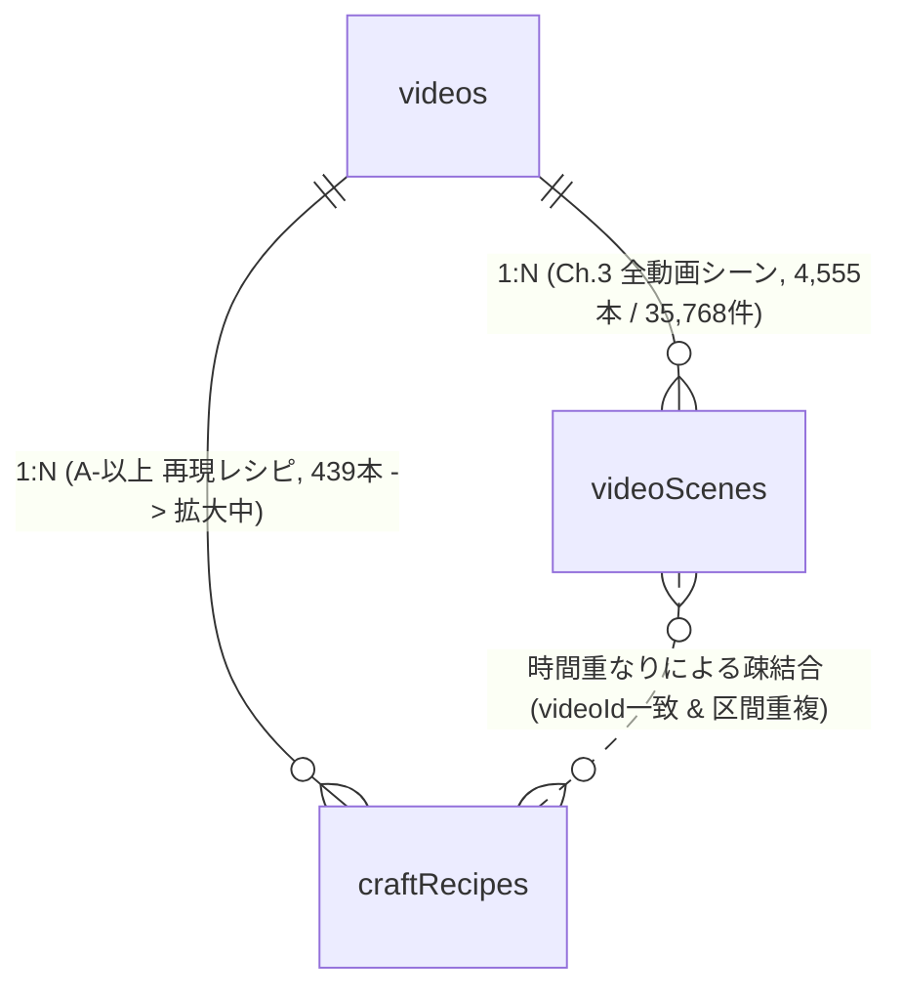

# サイト検索（Twelve Labs 風カット・シーン検索）および `videoScenes` / `craftRecipes` 連携 設計書

- **作成日**: 2026-11-25（`CHIBA-PC`）
- **ステータス**: **設計案（未実装・承認待ち）**
- **ブランチ**: `docs/site-cut-search-design`（※ `origin/main` 時点では本書が未作成だったため、カット検索・`expressive_purpose` 活用・方式比較・テーブル連携の章を先行起案。他 PC でサイト表示側の先行章を作成済みの場合はマージ時に章統合する前提）
- **関連文書**: `docs/CRAFT_RECIPE_DISTRIBUTION_DESIGN.md`（`9c8fb60`）、`docs/API_CRAFT_RECIPE_DESIGN.md`（`c81a1b5`）、`docs/DECISIONS.md`（D-022, D-023）
- **項目名に関する前提**: `chibatmute` が検討中の `expressive_purpose` 配下の項目名（`intent_summary` / `viewer_effect` / `narrative_role` / `best_for` / `avoid_when` / `search_keywords` / `evidence`）は**仮称**として記述し、`chibatmute` 側のスキーマ確定後に正式名へ揃える。

---

## 1. 現行サイト検索の現状（コード・DB 実測）

### 1-1. 全体構成（すべてクライアント側処理・サーバー検索なし）
- **サーバー側（TiDB / tRPC）**:
  - `server/routers.ts`（L270–284）の `videos.list` が `server/db.ts`（L133–160）の `getAllVideoListItems()` を呼び、TiDB `videos` テーブル全 **5,653 本**の一覧メタデータを一括返却するのみ。
  - 重量の大きい `aiAnalysis` 本文・`aiScoreBreakdown`・`metadataClassificationAudit` は SQL レベルで除外されている。
  - 検索クエリを受けるサーバー側エンドポイント、TiDB 全文検索、TiDB ベクトル検索は現在存在しない。
- **現在の TiDB 環境（読み取り専用実測）**:
  - リージョン: `ap-northeast-1.prod.aws.tidbcloud.com`（東京）
  - バージョン: `8.0.11-TiDB-v8.5.3-serverless`
  - 既存テーブル（9 個）: `videos`, `users`, `favoriteProfiles`, `profileVideoFavorites`, `profileCreatorFavorites`, `dailyCollectionSources`, `dailyCollectionRuns`, `aiMetadataCompletionJobs`, `aiMetadataCompletionRuns`（`videoScenes` / `craftRecipes` は未作成）

### 1-2. 現行の 2 つの検索モードと該当コード

| 検索モード | 該当ファイル・コード箇所 | 検索対象 | 検索方式 | 出力単位・UI |
|---|---|---|---|---|
| **動画一覧モード（標準検索）** | `client/src/hooks/useVideos.ts`<br>・`parseSearchQuery`（L224–249）<br>・`getVideoSearchText`（L251–274）<br>・`applyVideoFilters`（L276–361）<br>`client/src/pages/Home.tsx`（L343–351） | タイトル、`channelTitle`、`allTags`、`purposes`、`expressions`、`toneEmotions`、`toneVisuals`、`toneTechniques`、`productions`、`productionCredits`（役割）、評価文字、`curationNote`（4 項目）。<br>※ `aiAnalysis` 本文・シーン・レシピは**対象外** | ブラウザ内の小文字結合文字列に対する `String.prototype.includes()` **AND 部分一致**（`-語` 除外・`-source:xxx` 除外対応）。関連度ランキングなし | **動画単位**（`VideoCard.tsx`） |
| **シーン・秒数検索モード（Twelve Labs 風プロトタイプ）** | `client/src/lib/sceneSearch.ts`<br>・`loadSceneIndex`（L328–374）<br>・`SYNONYM_MAP`（L377–412、35 語）<br>・`searchScenes`（L446–536）<br>・`getSceneKeywordCategories`（L617–664）<br>`client/src/lib/scenes_index.json`（＋`client/public/scenes_index.json`、3.32 MB）<br>`client/src/components/SceneCard.tsx`（L23–305）<br>`client/src/pages/Home.tsx`（L135–176, L213–262, L511–820） | 静的 JSON **`scenes_index.json`（5,288 シーン / 342 本分のみ）** の `visual`, `keywords`, `audio`, `videoTitle` | ブラウザ内でスペース分割 → 手動 35 語の `SYNONYM_MAP` で展開 → `includes()` **AND 部分一致**＋固定重み加算（`visual:15 / keywords:10 / audio:8 / title:5`） | **シーン単位**（`SceneCard.tsx`：時間帯バッジ、タイムラインバー、YouTube iframe ホバー区間再生、説明文、`#キーワード` チップ 4 個、クリックで該当秒から `VideoModal` 再生） |

### 1-3. 現行「シーン・秒数検索」の 4 つの構造的ボトルネック
1. **収録本数が全体の約 6% に固定されている**: `scenes_index.json` には 342 本（5,288 シーン）しか入っていない。`loadSceneIndex(allVideos)`（`sceneSearch.ts` L362）は未収録動画の `v.aiAnalysis` から動的抽出する処理を持つが、`videos.list` が SQL で `aiAnalysis` を除外しているため実質機能しておらず、ローカル SQLite に実在する **4,555 本 / 35,768 シーン** の大半が検索に乗らない。
2. **自然文クエリに弱い**: スペース区切り AND 部分一致のため、「冒頭で一気に視線を奪う緊張感のあるタイポ」「商品スペックを分かりやすく見せる静かな切り替え」のような自然な日本語文は 1 トークン扱いになり **0 件** になりやすい。
3. **サムネイルがカット固有ではない**: `SceneCard.tsx` は `https://img.youtube.com/vi/${videoId}/hqdefault.jpg`（動画代表静止画）固定であり、該当カットの見た目が一目で分からない。
4. **既存フィルタおよびクラフトレシピと分断されている**: シーンモードでは左サイドバーが非表示（`Home.tsx` L355）で、用途・表現・トンマナ・校正点数での絞り込みができず、クラフトレシピやカットの「目的（`expressive_purpose`）」も未連携。

---

## 2. カット単位検索の UX・結果カード設計（Twelve Labs 風）

既存の `SceneCard.tsx`（タイムライン位置バー＋ホバープレビュー＋クリック時 `startSeconds` 直接再生）を土台に、`expressive_purpose` とクラフトレシピ情報を載せた **カット単位の検索結果カード（`CutResultCard` 仮称）** へ発展させる。

### 2-1. カット結果カードの表示項目

```text
+-------------------------------------------------------+
| [01:12 - 01:16]              [レシピ v2] [94% Match]   |
|                                                       |
|          カット固有サムネイル (mid_png 等)              |
|     (ホバー時: ループGIF / YouTube区間ミュート再生)      |
|                                                       |
| ======[====]========================================= |  <- 動画全体尺上の位置バー
+-------------------------------------------------------+
| 動画名: TVアニメ『呪術廻戦』第3期 OP ...     [S 94.5]  |
| 狙い : 4人の新キャラを0.5秒刻みの矩形コラージュで      |  <- expressive_purpose.intent_summary (1文)
|        連続提示し、情報密度と高揚感を一気に引き上げる   |
| 役割 : [転換・テンポ加速]  効果: [高揚感] [疾走感]      |  <- narrative_role / viewer_effect バッジ
| 語句 : [#矩形コラージュ] [#高速切替] [#枠線構成] [+2]   |  <- search_keywords チップ（一致語ハイライト）
| ツール: After Effects (Motion 4, Flow)                |  <- craftRecipes 由来時のみ表示
+-------------------------------------------------------+
```

| 要素 | 表示元フィールド（仮称） | フォールバック（`videoScenes` のみの場合） | インタラクション |
|---|---|---|---|
| **サムネイル** | `craftRecipes.mediaUrlManifestJson.mid_png`（将来 Web 配信時） | YouTube `hqdefault.jpg`（ホバー時 iframe 区間再生＋`hq1..3` 切替） | ホバー 350ms でループ GIF または YouTube 区間再生 |
| **カット時間帯** | `startMmss - endMmss`（`startSec`, `endSec`）＋タイムラインバー | `videoScenes.startMmss - endMmss` | クリックで `VideoModal` を `startSec` から直接再生 |
| **動画名・スコア** | `videos.title` ＋ `calibratedRank` / `calibratedScore` | 同左 | クリックで `VideoModal` を開き該当レシピ／シーンタブへ遷移 |
| **狙いの 1 文** | `expressive_purpose.intent_summary`（1〜2 行・60〜80 字目安） | `videoScenes.shotTitle` ＋ `description` の 1 文要約 | ホバー／詳細展開で `evidence`・`avoid_when` を確認可 |
| **キーワードチップ** | `expressive_purpose.search_keywords`（上位 4〜6 個） | `videoScenes.keywordsJson` | クエリ一致語を強調表示。クリックで検索条件へ追加絞り込み |
| **種別・ツール表示** | `レシピ v2` バッジ＋ `primaryTool` / 代表プラグイン | `シーン` バッジ（レシピ未作成であることを明示） | ツール名クリックで同ツール絞り込み |

---

## 3. `viewer_effect` / `narrative_role` / `best_for` の絞り込み設計（既存タグ語彙との統一）

既存の動画一覧サイドバー（`Sidebar.tsx` / `shared/metadataOptions.ts`）で使われている語彙と **言葉の体系を揃える** ことで、「動画単位で探す感覚」と「カット単位で探す感覚」の断絶を防ぐ。

### 3-1. 既存タグ体系（コード・TiDB 実測）との対応表

| `expressive_purpose` 項目（仮称） | 絞り込み上の位置づけ | 揃える既存語彙・正規化ルール | 値の例 |
|---|---|---|---|
| **`best_for`**（向いている案件・用途） | **既存「用途（`purposes`）」フィルタと完全統一** | `shared/metadataOptions.ts` の **`PURPOSE_OPTIONS`（13 語）** を正準語彙として採用（必要に応じて `GENRE_OPTIONS` を補助マッピング）。既存 `restrictToAllowedOptions()` と同じ正規化を通す | `プロモーション`, `ブランディングムービー`, `MV`, `ティザー`, `OPED`, `事業・サービス紹介`, `採用・リクルーティング`, `イベント・空間演出`, `ハウツー・解説`, `アート`, `インタビュー`, `企画系` |
| **`viewer_effect`**（視聴者への心理・知覚効果） | **既存「感情トンマナ（`toneEmotions` / `TONE_OPTIONS`）」フィルタと統一** | `TONE_OPTIONS` 12 軸および TiDB 実測の頻出 `toneEmotions` 上位語（`疾走感`, `高揚感`, `緊張感`, `爽快`, `洗練`, `切なさ`, `不穏`, `静謐`, `多幸感`, `シュール`, `ユーモア`, `カオス`, `ノスタルジー` 等）を正準セットに揃え、知覚効果固有の数語（例：`注目喚起・つかみ`, `理解促進・整理`, `ブランド格上げ`）のみ追加する。細かなニュアンスは `intent_summary` に残し、絞り込みは正規タグで行う | `高揚感`, `疾走感`, `緊張感`, `洗練`, `爽快`, `不穏`, `静謐`, `多幸感`, `注目喚起・つかみ`, `理解促進・整理` |
| **`narrative_role`**（動画構成上の役割） | **カット検索専用の構造軸（新規 8 値固定）** | 既存の動画単位タグには存在しない「尺のどこで使うカットか」の軸。制作実務の 8 値に固定列挙し、カット検索上部のクイックピルとして配置する | `冒頭フック`, `導入・世界観提示`, `展開・テンポ加速`, `転換・トランジション`, `情報整理・説明`, `サビ・クライマックス`, `余韻・間（ブリーザー）`, `エンドカード・ロゴ着地` |
| **`avoid_when`**（避けるべき条件） | **詳細表示の注意ラベル＋任意マイナス条件** | 自由文のままカード詳細・レシピパネルに「不向きな場面」として表示（例：「長文をじっくり読ませたい BtoB 解説には不向き」）。初期段階ではサイドバー固定タグにはせず、自然文・ベクトル検索のネガティブ文脈および制作者判断の補助に使う | （例）`静止可読時間が必要な説明カット`、`低予算短納期の実写案件` |
| （補助）**表現・演出・ツール** | **既存「表現（`expressions`）」「演出（`directions`）」と連動** | `craftRecipes.category` / `primaryTool` および親動画 `videos.expressions` / `directions` / `toneVisuals` を引き継いで絞り込み可能にする（例：`Blender` → `3D`、`kinetic_typography` → `タイポグラフィ・グラフィック`） | `2D`, `3D`, `実写`, `アニメーション`, `タイポグラフィ・グラフィック` 等 |

### 3-2. 絞り込み UI の配置
- 既存の「シーン・秒数検索」では非表示だった **左サイドバー（または上部コンパクトフィルタバー）をカット検索モードでも有効化** し、以下を AND 絞り込み可能にする：
  1. **自然文検索ボックス**（Twelve Labs 風）
  2. **構成役割（`narrative_role`）クイックピル**（`冒頭フック` / `転換` / `クライマックス` / `ロゴ着地` 等）
  3. **既存共通フィルタ**：用途（`best_for` 連動）、感情・効果（`viewer_effect` / `toneEmotions` 連動）、表現（`expressions`）、ジャンル（`genres`）、校正点数帯（既定 `A- / 78点以上` または `すべて`）、対象種別（`レシピ優先＋シーン` / `レシピのみ` / `シーンのみ`）

---

## 4. 検索方式の比較（TiDB 全文検索 vs ベクトル検索 vs 両方併用）

### 4-1. 運用環境と埋め込み（Embedding）作成方法・費用試算

- **TiDB 側の前提（実測確認済み）**:
  - 本番クラスタは **`8.0.11-TiDB-v8.5.3-serverless`（東京 `ap-northeast-1`）**。
  - 東京リージョンの TiDB Cloud Serverless は、**日本語対応の全文検索（`FULLTEXT INDEX ... WITH PARSER MULTILINGUAL`・BM25）** と **HNSW ベクトル検索（`VECTOR(dim)` + `VEC_COSINE_DISTANCE`）** の両方を追加 DB なし・無料枠（行 5 GiB / TiFlash 列 5 GiB / 月 5,000 万 RU〜）内でそのままサポートしている。
- **埋め込み（Embedding）作成方法と実測単価ベースの見積もり**:
  - **使用モデル候補（Gemini API 公式料金・2026-11 確認）**:
    - **`gemini-embedding-2`**（最新安定版・マルチモーダル統一空間・推奨次元 `768 / 1536 / 3072`）: テキスト入力 **Standard `\$0.20 / 1M tok`**、**Batch `\$0.10 / 1M tok`**（将来カット静止画 `mid_png` も同一空間に埋め込む場合：Standard `\$0.00012 / 枚`、Batch `\$0.00006 / 枚`）
    - **`gemini-embedding-001`**（テキスト専用・2028-05 まで稼働）: **Standard `\$0.15 / 1M tok`**、**Batch `\$0.075 / 1M tok`**
  - **推奨次元数**: **`VECTOR(768)`**（Matryoshka 圧縮・`float32` = `3 KB/行`）。全 35,768 シーン＋将来 9,000 レシピカット（計 約 45,768 行）でもベクトル容量は **約 137 MB**（TiFlash 無料枠 5 GiB の **2.7%**）。
  - **埋め込み対象テキストの組み立て**:
    - `craftRecipes`: `title` + `expressive_purpose.intent_summary` + `viewer_effect` + `narrative_role` + `best_for` + `search_keywords` + `category` + `primaryTool` + `plugins` + 親動画 `title`（1 カット平均 約 200 tok）
    - `videoScenes`: 親動画 `title` + `shotTitle` + `description` + 親動画主要タグ（1 シーン平均 約 150 tok）
  - **作成タイミング**: DB 同期スクリプト（`sync-craft-recipes-to-tidb.mjs` / `sync-scenes-to-tidb.mjs`）実行時に、テキストの SHA-256（`embeddingTextSha256`）が変わった行だけ増分生成して TiDB へ保存する（再実行時の無駄課金ゼロ）。
  - **費用試算（`gemini-embedding-2` テキスト Standard / Batch）**:

| 対象規模 | 想定トークン量 | Standard 費用 | Batch 費用 | 備考 |
|---|---:|---:|---:|---|
| 現行レシピのみ（1,040 カット） | 約 0.21M tok | **\$0.04** | \$0.02 | 即時検証レベル |
| 将来レシピ全量想定（A- 以上 3,000 本 × 3 = 9,000 カット） | 約 1.80M tok | **\$0.36** | \$0.18 | レシピ増分のみ |
| 既存 `videoScenes` 全量（35,768 シーン） | 約 5.37M tok | **\$1.07** | \$0.54 | 全 4,555 本カバー |
| **初回フル構築合計（シーン全量＋将来レシピ全量）** | **約 7.17M tok** | **\$1.43**（約 215 円） | **\$0.72**（約 110 円） | `gemini-embedding-001` なら約 25% 安 |
| **検索時クエリ埋め込み（1 万回検索・平均 30 tok/回）** | 約 0.30M tok | **\$0.06**（約 9 円） | — | ほぼゼロ費用（同一クエリは短時間キャッシュ可） |

### 4-2. 3 方式の比較表

| 評価軸 | 案 A：TiDB 全文検索のみ<br>（`MULTILINGUAL` BM25） | 案 B：TiDB ベクトル検索のみ<br>（`VECTOR(768)` + HNSW） | **案 C：両方併用（ハイブリッド）**<br>（BM25 ＋ HNSW ＋ RRF 統合） |
|---|---|---|---|
| **初期・運用費用** | **\$0**（TiDB 無料枠内） | **極小**（初回全件 `\$0.7〜\$1.4`、検索 1 万回 `\$0.06`） | **極小**（案 B と同じ。TiDB 単一クラスタで追加 DB 不要） |
| **実装・運用の手間** | **低**：DDL と SQL 検索 API のみ。外部 API キー不要 | **中**：同期時の埋め込み生成、Vercel 側へのクエリ用 API キー設定、API 障害対策が必要 | **中＋小**：案 B に加え、同一 TiDB 内で FTS と Vector の 2 クエリを並列実行し RRF（Reciprocal Rank Fusion）で合成。**API 障害時は自動で案 A へフォールバック可能** |
| **自然文・意図検索の質**<br>（例：「冒頭で視線を奪う緊張感のある切り替え」） | **△（弱い）**：語句の表記ゆれ・抽象表現でヒット漏れや 0 件が起きやすい | **◎（強い）**：`intent_summary` や `viewer_effect` の意味近傍を高精度に拾える | **◎（最高）**：意味の近さをベクトル検索が担保 |
| **固有名詞・技法・プラグイン名一致**<br>（例：`Deep Glow`, `DisplacerPro`, `呪術廻戦`） | **◎（強い）**：完全一致・トークン一致で確実に最上位に出る | **△（ぼやける）**：レアなプラグイン名や型番・作品名の厳密一致で順位が落ちることがある | **◎（最高）**：BM25 が固有名詞・プラグイン名を確実に上位へ押し上げる |
| **既存タグ絞り込みとの相性** | **◎**：SQL `WHERE` で厳密併用 | **○**：HNSW 後のフィルタリングで件数減（pre/post-filter の調整が必要） | **◎**：SQL `WHERE` 条件付きの FTS＋Vector を RRF 統合でき、0 件事故が起きにくい |
| **応答速度** | 最速（数十 ms） | 速い（クエリ埋め込み 150〜350 ms ＋ HNSW 数十 ms） | 速い（クエリ埋め込み 150〜350 ms ＋ TiDB 並列数十 ms） |

### 4-3. おすすめ方式（1 つ）：**案 C「両方併用（TiDB 単一クラスタ内ハイブリッド検索）」**

- **採用理由**:
  1. **Twelve Labs 風体験の核心である「自然文での意図検索」と、制作現場で必須の「プラグイン名・技法名・既存タグでの厳密絞り込み」を同時に満たせるのは案 C だけ**。
  2. 東京リージョン（`ap-northeast-1`）の既存 TiDB Serverless 単体で完結し、Pinecone/Elasticsearch 等の別サービスを増やさずに済む。
  3. 埋め込みコストは全 4.5 万行でも初回 **約 `\$0.7〜\$1.4`**・検索 1 万回 **`\$0.06`** と極めて小さく、さらに Gemini API 障害時や 1 語ショートクエリ時には自動で TiDB 全文検索へフォールバックできるため可用性も高い。
  4. 将来カット固有静止画（`mid_png`）の Web 配信が整った際、`gemini-embedding-2` を使っておけば **テキストと同じベクトル空間へ画像埋め込みを追加して「見た目・色・構図での類似カット検索」へそのまま拡張できる**。
- **ハイブリッド順位合成（RRF）の具体イメージ**:
  - 検索 API（例：`trpc.cuts.search`）が以下を並列実行：
    1. TiDB 全文検索（`fts_match_word()` / BM25、上位 50 件）
    2. クエリを `gemini-embedding-2`（`task_type: RETRIEVAL_QUERY`, `output_dimensionality: 768`）で埋め込み → TiDB HNSW（`VEC_COSINE_DISTANCE`, 上位 50 件）
  - 既存フィルタ（`best_for` / `viewer_effect` / `narrative_role` / `purposes` / `expressions` / `calibratedScore >= 78` 等）を適用し、RRF スコア
    $$\text{score}(d) = \frac{w_{\text{vec}}}{60 + \text{rank}_{\text{vec}}(d)} + \frac{w_{\text{fts}}}{60 + \text{rank}_{\text{fts}}(d)} + \text{boost}_{\text{recipe/score}}$$
    （例：$w_{\text{vec}} = 1.0$, $w_{\text{fts}} = 0.8$、レシピ v2 に軽微ブースト）で並べ替える。
  - **安全な 2 段階導入**: 先に Phase 1 でテーブル＋TiDB 全文検索＋UI をブランチ＆プレビューで立ち上げ、Phase 2 で `embedding` 列（`VECTOR(768)`）と RRF 合成を追加する手順にすれば、初回の改修リスクを抑えながら確実にハイブリッドへ到達できる。

---

## 5. `videoScenes` と、後で作る `craftRecipes` 表の関係

### 5-1. 役割分担とスキーマ関係図



| 観点 | `videoScenes`（新規・全動画ベース） | `craftRecipes`（`CRAFT_RECIPE_DISTRIBUTION_DESIGN.md` §5-2 準拠） |
|---|---|---|
| **正本ソース** | TiDB `videos.aiAnalysis` の Ch.3（`SCENE_RE` パース結果） | Google ドライブ `iketeru_craft_recipes/<video_id>/recipe.json`（および API ② 出力） |
| **対象範囲** | 実視聴分析済み（`analysisObservationScope IS NULL`）の全動画（現在 **4,555 本 / 35,768 シーン**） | 補正後 **A-（78 点）以上**のレシピ化済み動画（現在 439 本 / 1,040 カット → 段階拡大） |
| **カット粒度** | ストーリー・情景の区切り（概ね 5〜15 秒単位） | 再現テクニック単位（`0.5〜15 秒`、`micro_transition` / `technique_unit` / `complex_composite`） |
| **強み・保持項目** | 動画全編を網羅する時系列情景（`shotIndex`, `startSec`, `endSec`, `shotTitle`, `description`, `keywordsJson`） | 制作レシピ本体（`primaryTool`, `pluginsJson`, `paletteJson`, `recipeJson`）＋ **`expressive_purpose`（仮称：狙い・視聴者効果・構成役割・向く案件・避ける条件・検索キーワード・根拠）** ＋カット固有メディア参照 |
| **検索インデックス列（案）** | `searchText`（FULLTEXT `MULTILINGUAL`）＋ `embedding VECTOR(768)`（HNSW） | `searchText`（FULLTEXT `MULTILINGUAL`）＋ `embedding VECTOR(768)`（HNSW）＋絞り込み用 JSON/正規列（`expressivePurposeJson`, `narrativeRole`, `viewerEffectsJson`, `bestForJson`, `searchKeywordsJson`） |

### 5-2. 2 テーブルを「並列の子テーブル（疎結合）」にする理由
1. **境界が 1 対 1 にならない**: `videoScenes` はストーリー展開の粗い区切り（例：`01:08–01:19` の 11 秒）である一方、`craftRecipes` はその一部を切り出した `01:12–01:16` や `0.5 秒` のマイクロ遷移になるため、外部キーで 1 対 1 に縛ると破綻する。
2. **更新ライフサイクルが独立している**: `videoScenes` は `videos.aiAnalysis` の更新時に再展開され、`craftRecipes` は Google ドライブ正本からの `sync-craft-recipes-to-tidb.mjs` で独立同期される。並列構造にしておけば互いの再同期で参照整合性エラーが起きない。
3. **必要なときだけ時間重なりで結合できる**: 詳細モーダルや相互参照では `c.videoId = s.videoId AND c.startSec < s.endSec AND c.endSec > s.startSec`（区間オーバーラップ）で関連シーンを即時取得でき、必要なら `craftRecipes` に任意の補助列 `overlappingSceneId`（NULL 可）を持たせられる。

### 5-3. 統合検索時の重複抑止と優先ルール
1. **検索対象モード**: 既定は **「すべて（レシピ優先＋シーン補完）」** とし、UI のセグメント切替で **「レシピのみ」「シーンのみ」** にも切り替え可能にする。
2. **同一動画・同一時間帯の重複集約**: 検索結果に同一 `videoId` で時間区間が大きく重なる（例：時間重なり率 `IoU >= 0.4` または中心差 `<= 3 秒`）`craftRecipes` 行と `videoScenes` 行の両方が含まれる場合、情報密度と `expressive_purpose` が揃っている **`craftRecipes` 側を優先して 1 枚のカードに集約** する（シーン側のみにある情景補足は必要時に詳細へ併記）。
3. **未視聴除外の徹底（ルール 2 準拠）**: `videoScenes` / `craftRecipes` ともに検索クエリ側で親 `videos` の `analysisObservationScope IS NULL`（および削除・非公開除外）を既定条件とし、未視聴分析由来の低品質ヒットを混ぜない。
4. **既存 `scenes_index.json`（3.32 MB）の廃止ロードマップ**: `trpc.cuts.search`（TiDB 検索）のプレビュー検証・承認が完了した段階で、クライアントバンドルを肥大化させている `client/src/lib/scenes_index.json` と `client/public/scenes_index.json` を段階的に廃止し、常に最新 5,653 本の DB と同期した検索へ一本化する。

---

## 6. 実装前に決める必要がある事項（ユーザー承認項目）

1. **検索方式の採用**: 案 C（TiDB 全文検索 BM25 ＋ `gemini-embedding-2` 768 次元 HNSW ベクトル検索のハイブリッド・RRF 統合）を Phase 1（全文検索＋UI 先行）→ Phase 2（ベクトル追加）の 2 段階で進めてよいか。
2. **埋め込みモデルの選定と API キー配置**: `gemini-embedding-2`（将来画像拡張可、テキスト Standard `\$0.20/1M`）とするか `gemini-embedding-001`（テキスト専用 `\$0.15/1M`）とするか。またクエリ時埋め込み用に Vercel サーバー側環境変数へ専用制限付き Gemini API キーを設定してよいか（上限設定・クエリキャッシュ込み）。
3. **`expressive_purpose` の正式スキーマ確定**: `chibatmute` の最終案が確定した時点で、本書の仮称（`intent_summary` / `viewer_effect` / `narrative_role` / `best_for` / `avoid_when` / `search_keywords` / `evidence`）と正準語彙リスト（特に `narrative_role` の 8 値と `viewer_effect` の追加語）を確定する。
4. **カット固有サムネイルの Web 配信方式**: レシピカードでカット固有静止画（`mid_png`）・ホバー GIF を表示する際のホスティング先（Cloudflare R2 / S3 等）を Phase 1 では既存 YouTube 区間ホバー再生で先行し、別タスクで接続するか。
5. **TiDB テーブル追加のタイミング**: `videoScenes` と `craftRecipes` の DDL を同時適用するか、`craftRecipes`（`docs/CRAFT_RECIPE_DISTRIBUTION_DESIGN.md`）とタイミングを合わせるか（いずれも `--dry-run` → ユーザー承認 → 反映ロック手順厳守）。
