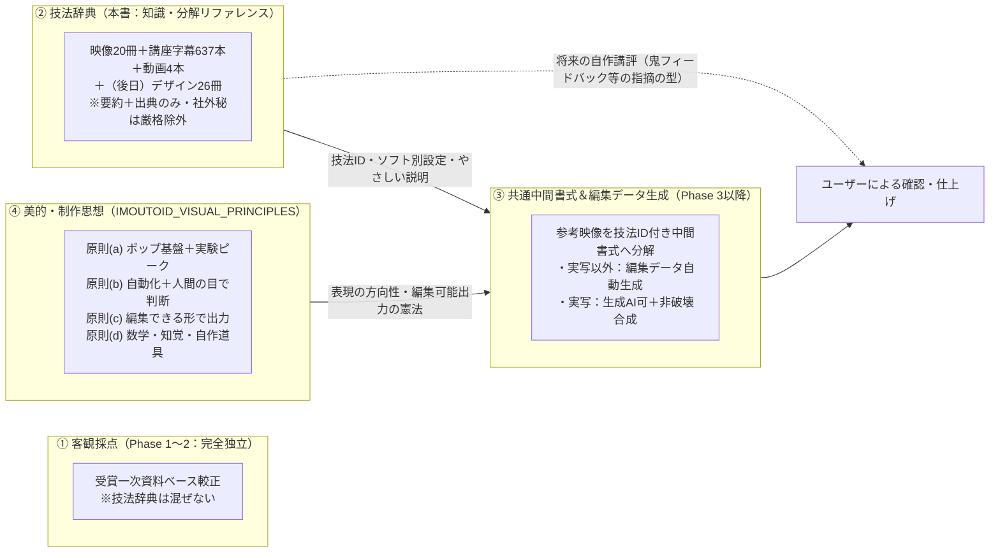

# 技法辞典（Technique Dictionary）設計書＆ライティング試作 10 項目

- **文書ステータス**: 設計案＋試作 10 項目（Phase 2 較正テストと並行整備・**DB 実装およびデザイン書 26 冊の取り込みは未着手**）
- **作成日**: 2026-11-23
- **関連文書**:
  - [VISUAL_DECOMPOSITION_AND_GENERATION_VISION.md](VISUAL_DECOMPOSITION_AND_GENERATION_VISION.md)（映像の分析・分解と編集データ自動生成の最終的な姿）
  - [IMOUTOID_VISUAL_PRINCIPLES.md](IMOUTOID_VISUAL_PRINCIPLES.md)（制作思想の 4 原則）
  - [CALIBRATION_PHASE2_DESIGN.md](CALIBRATION_PHASE2_DESIGN.md)（Phase 2 較正テスト設計書 ※採点領域）
  - [glossary.md](glossary.md)（用語集） / [how-it-works.md](how-it-works.md)（処理の見える化）
- **リポジトリ外インデックス**: `E:\技術書_index\toc_catalog.md`（全資料の目次・章立て一覧・YouTube 637 本カタログ）

---

## 0. 位置づけと厳守ルール

1. **較正済み採点（受賞ベースの点数）とは完全に分離する**
   - 技法辞典は、参考映像を「どのソフトの・どんな処理・どんな撮影技術で再現できるか」に分解・説明するための**知識リファレンス**である。
   - Phase 1〜2 で検証している客観採点（受賞一次資料にもとづく 100 点満点評価）の採点基準には**一切混ぜない**。
2. **著作権・引用ルール（リポジトリ・DB への本文保存禁止）**
   - 手元資料の全文閲覧はローカル環境内のみとし、**長い抜き書きや全文コピーはリポジトリにも DB にも保存しない**。
   - 残すのは **「自分の言葉での短い要約＋出典（書名・章／ページ、または動画名・時刻）」** のみとする。やむを得ず原文を引用する場合は 1 か所につき 1〜2 文以内＋出典明記とする。
   - `.txt` と `_OCR.txt` で内容が食い違う箇所がある場合は、元の PDF ページで事実確認する。
   - 目次抽出や途中の作業ファイルはすべてリポジトリ外（`E:\技術書_index\`）に置く。
3. **対象資料の段階的取り込みと除外ルール**
   - **第1段階（現在・試作対象）**：`E:\技術書\映像`（専門書 20 冊・YouTube 講座字幕 637 本・講座動画 4 本）から型を検証。
   - **第2段階（Phase 2 完了＋映像試作の型確定後）**：`E:\技術書\デザイン`（デザイン書 26 冊：配色・タイポグラフィ・レイアウト・Photoshop／Illustrator・講評の型）を同一書式で取り込む。
   - **厳格な除外（絶対遵守）**：
     - **`E:\技術書\マーケティング\新卒採用マニュアル.txt` は「社外秘」と明記された社内資料のため、読まない・送らない・参照しない。**
     - 同フォルダの市販書 2 冊（『あなたの会社が90日で儲かる！』『未来実現マーケティング』）も現時点では対象外。

---

## 1. 手元資料の分野対応表（概要）

全 20 冊の章立て・YouTube 字幕 637 本の詳細カタログはリポジトリ外の `E:\技術書_index\toc_catalog.md` に整理済み。ここでは「どの分野をどの資料が担うか」の全体マップを示す。

| 分野 | 主な担当書籍（`E:\技術書\映像`） | 主な担当講座（字幕・動画） | 後日追加予定（`E:\技術書\デザイン`） |
|---|---|---|---|
| **光（ライティング）** | 『画づくりのための光の授業』『VISION』『映画制作の教科書』『完全独学マニュアル』 | Hissy Studio（53本：`ライティングなんてこわくない` vol.1〜40）、Yuichi Ishida（照明実践）、SATΘSHI Film（物撮り・鏡） | ― |
| **構図** | 『プロの撮り方 構図の法則』『構図を極める』『VISION』 | Hissy Studio（29本）、Yuichi Ishida（24本）、SATΘSHI Film（12本） | レイアウト・余白系書籍と連携 |
| **カメラワーク** | 『マスターショット100 ①②』『映画制作の教科書』『完全独学マニュアル』 | Yuichi Ishida（16本）、SATΘSHI Film | ― |
| **色（カラー）** | 『COLOR GRADING TRANING BASIC / Advances』『画づくりのための光の授業』『VISION』 | Hissy Studio（40本）、Yuichi Ishida（15本：S-Log3 教科書等）、SATΘSHI Film（6本） | 『COLOR DESIGN』等の配色書と連携 |
| **AEエフェクト** | 『After Effects 標準エフェクト全解』『everyday-one-motion ①②』『VIDEO SALON 2冊』 | 講座動画『AEで作る「懐かしい」記憶』『Nate の美学』『アンビバレント MV』 | ― |
| **AE自動化** | 『After Effects 自動化サンプルプログラム 上』『everyday-one-motion ①』 | ― | ― |
| **3D（Blender等）** | 『VIDEO SALON 3DCGセルルックアニメ制作の世界』『everyday-one-motion ①②』 | 3D bibi（74本：モデリング・シェーダ・アニメーション・Tips100選） | ― |
| **モーション** | 『everyday-one-motion ①②』『VIDEO SALON イラスト×映像』 | 講座動画『Nate の美学』『しぐれうい「ひっひっふー」MV』『アンビバレント MV』 | タイポ・レイアウト系と連携 |
| **編集** | 『伝わる映像』『また見たい！と思わせる動画の法則』『映画制作の教科書』『「動画制作」プロの仕掛け』 | Hissy Studio（25本）、Yuichi Ishida（18本）、SATΘSHI Film（14本） | ― |
| **企画・演出** | 『伝わる映像』『映画制作の教科書』『教養としての映像／動画』『「動画制作」プロの仕掛け』 | ― | 『すべての仕事はクリエイティブディレクションである』等 |
| **配色・タイポ・レイアウト・Ps/Ai**（※後日取り込み） | ― | ― | 『COLOR DESIGN』『ほんとに、フォント。』『けっきょく、よはく。』『Photoshop/Illustrator よくばり入門・デザインテクニック大全・超絶レタッチ術』『ロゴ・幾何学パターン』等（26冊） |
| **講評の「指摘の型」**（※将来の自作講評用） | ― | ― | 『鬼フィードバック』『クイズdeデザイン』等（採点基準とは完全分離し、自分の作品への改善アドバイス言語化に活用） |

---

## 2. 「技法辞典」の項目の型（記録スキーマ案）

映像・デザインの全領域を統一して扱えるよう、**12 分類**（映像 8 分類＋デザイン拡張 4 分類）＋別枠「講評の指摘の型」で設計する。

- **分類（`category`）一覧（12 分類）**：
  - 映像 8 分類：`ライティング（光）` / `構図` / `カメラワーク` / `編集` / `エフェクト` / `色（カラーグレーディング）` / `3D` / `モーション`
  - デザイン拡張 4 分類：`配色` / `タイポグラフィ` / `レイアウト` / `Photoshop／Illustrator の処理`

### 1 項目の記録スキーマ（JSON 構造案）

```json
{
  "technique_id": "LIGHT-001",
  "name_ja": "技法名（日本語）",
  "name_en": "Technique Name (English)",
  "category": "ライティング（光）",
  "sub_category": "光源の質（硬さ／柔らかさ）",
  "plain_explanation": "専門用語を噛み砕いた2〜3行のやさしい説明",
  "visual_effect_and_mood": "画にどんな印象・立体感・感情が生まれるか",
  "reproduction_by_tool": {
    "live_action": "実写での機材・ライト配置・距離・角度・ディフューザー等の目安（該当なしは null）",
    "after_effects": "AE のライトレイヤー・エフェクト名・主な設定値（該当なしは null）",
    "blender": "Blender のライト種別・サイズ・強度・ノード構成（該当なしは null）",
    "davinci_resolve": "Resolve の該当ノード（8ノード構成のどこか）・Power Window・カーブ操作",
    "premiere_pro": "Premiere の Lumetri Color や編集上の操作（該当なしは null）",
    "photoshop_illustrator": "Photoshop / Illustrator でのレイヤー・描画モード・グラデーション再現",
    "code_and_oss": "p5.js / GLSL シェーダ / ffmpeg / Remotion / TouchDesigner 等での数理・実装指針（※利用条件は個別確認）"
  },
  "sources": [
    {
      "type": "book | youtube_srt | lecture_mp4",
      "title": "書名 または 動画タイトル（チャンネル名）",
      "location": "章・ページ番号（例：Ch.5）または 時刻（例：04:51–10:45）",
      "summary_note": "自分の言葉での1〜2行要約（本文コピー禁止）"
    }
  ],
  "db_video_links": [
    {
      "video_id": "iketeru-eizou 分析DBの動画ID",
      "time_range_sec": [12.0, 18.5],
      "usage_note": "このカットでどう使われているかの短いメモ"
    }
  ],
  "visual_ir_target": "live_action_capture.lighting | visual_effects | layers_and_elements",
  "critique_pattern_ref": "（任意・将来用）自作講評時に使う指摘の型ID（例：CRIT-LIGHT-01）"
}
```

---

## 3. 試作 10 項目（分野：ライティング＝『画づくりのための光の授業』＋実写撮影講座）

型の実用性を確かめるため、ライティング分野で 10 項目を試作した。すべて**自分の言葉による要約＋実在する出典（書名・章／動画名・時刻）**のみで構成している（※『画づくりのための光の授業』の正確な印刷ページ番号は、ローカル OCR 完了後に `E:\技術書_index\pdf_only_tocs_ocr.json` から章番号と合わせて確定追記する）。

---

### `LIGHT-001` 光源の大きさによる影の硬さ制御（点光源 vs 面光源）
- **分類**：`ライティング（光）` ＞ 光の質（硬さ／柔らかさ）
- **やさしい説明**：ライトの「発光する面積」が大きいほど光が回り込んで影の輪郭がぼやけ（柔らかい光）、面積が小さいほど影の輪郭がくっきり出ます（硬い光）。同じ明るさでも、柔らかい光は肌や商品をやさしく見せ、硬い光は緊張感や質感を強く押し出します。
- **再現できるソフトと具体的な処理**：
  - **実写**：柔らかい光はソフトボックスやアンブレラ・大きいディフューザー（拡散布）を被写体に近づけて「面光源」化。硬い光は裸電球・リフレクター直当て・遠い直射日光で「点光源」化。目の光（キャッチライト）も面光源なら大きく、点光源なら点になる。
  - **Blender**：`Area Light`（面ライト）の `Size` を大きくすると柔らかい影、`Point` / `Spot` の `Radius` を小さくすると硬い影になる。
  - **After Effects**：3D ライトの `Shadow Diffusion（シャドウの拡散）` を上げると面光源風の柔らかい影、`0` に近づけると硬い影になる。
  - **DaVinci Resolve**：撮影後の微調整として、`04 CONTRAST` で暗部の立ち上がりをなだらかにすると軟調寄り、S 字を強めると硬調寄りになる。
  - **p5.js / GLSL 等**：シャドウマップやレイトレーシングで光源半径（ペンアンブラ幅）をパラメータ化し、半影のぼかし幅を制御する。
- **出典**：
  - 書籍：『画づくりのための光の授業』Ch.1（基本原則：光の作用）、Ch.5（陰影：光源の大きさと距離・本影と半影）
  - 講座字幕：`Hissy Studio`『【ライティングなんてこわくない】vol.21「面光源」と「点光源」について。』`[ZsX8kzPEwr0]` `04:51–10:45`（ソフトボックスと点光源での影の境界・キャッチライトの違いを実写比較）
- **分析DB映像との紐づけ欄**：`db_video_links: []`（Phase 3 以降に該当カットの `video_id`・秒数を登録）

---

### `LIGHT-002` 距離による光の減衰制御（フォールオフ／逆二乗則の活用）
- **分類**：`ライティング（光）` ＞ 光の減衰・背景の明るさ制御
- **やさしい説明**：ライトを被写体に「近づける」ほど、少し後ろに下がるだけで光が急激に弱くなり、背景が暗く落ちます（フォールオフが大きい）。逆にライトを「遠ざける」と、手前と奥の明るさの差が減り、背景まで均一に明るくなります。
- **再現できるソフトと具体的な処理**：
  - **実写**：背景を暗く落として被写体だけ浮かび上がらせたいときは、ライトを被写体のすぐ近くへ寄せる（同時に見かけの光源サイズも大きくなり影も柔らかくなる）。背景まで明るく均一にしたいときはライトを離す。
  - **Blender**：物理ライトはデフォルトで逆二乗減衰。被写体と `Area Light` の距離を縮めるだけで背景落ちを再現可能（ノードの `Light Falloff` でも減衰カーブを調整可）。
  - **After Effects**：3D ライトの `Falloff（減衰）` を `Inverse Square Clamped` に設定し、`Radius` と `Falloff Distance` で背景への落ち方を制御する。
  - **DaVinci Resolve**：`07 LOOK` などで被写体周辺に楕円 `Power Window` を作り、外側（背景）の `Gain / Gamma` を落としてフォールオフ感を強調する。
  - **p5.js / GLSL 等**：フラグメントシェーダで `1.0 / (1.0 + k * d * d)` の距離減衰係数を調整する。
- **出典**：
  - 書籍：『画づくりのための光の授業』Ch.4（屋内照明と人工照明：フォールオフ）、Ch.7（拡散反射：光の減衰）
  - 講座字幕：`Hissy Studio`『【ライティングなんてこわくない】vol.19 超重要！ライトを当てる距離を変えるとどうなる？』`[_QL-uZ_HSZQ]` `02:55–07:44`（近・中・遠距離での影の輪郭と背景落ちの変化を実測比較）
- **分析DB映像との紐づけ欄**：`db_video_links: []`

---

### `LIGHT-003` 光の向きによる立体感と感情設計（フロント／サイド／トップ／フット）
- **分類**：`ライティング（光）` ＞ 光の向き（ディレクション）
- **やさしい説明**：カメラに対して「正面（順光）」「横（サイド）」「真上（トップ）」「真下（フット）」のどこから光を当てるかで、被写体の立体感や心理的な印象がガラリと変わります。正面は平面的だが肌をきれいに見せ、横は凹凸とドラマを生み、真上・真下は日常から外れた緊張や不気味さを演出します。
- **再現できるソフトと具体的な処理**：
  - **実写**：室内照明を一度すべて消して環境光をリセットし、メインの LED（例：ソフトボックス付きキーライト）を斜め横 45°〜90° に置くと立体的なインタビュー／映画調になる。
  - **Blender**：メイン `Area Light` の配置角度（被写体中心の水平角・仰角）で制御。トップは真上＋狭い `Spread`、フットは下向き床面配置。
  - **After Effects**：3D スポット／ポイントライトの位置座標（`Position`）とターゲット（`Point of Interest`）を被写体周囲に配置。2D 素材なら `CC Glass` / `Bevel Alpha` / `Drop Shadow` の角度で擬似再現。
  - **Photoshop / Illustrator**：法線方向に沿ったグラデーションマスク・覆い焼き／焼き込み（非破壊の 50% グレーオーバーレイ層）で立体明暗を描き起こす。
  - **p5.js / GLSL 等**：法線ベクトル `N` とライト方向ベクトル `L` の内積 `max(dot(N, L), 0.0)` でランバート拡散明暗を算出。
- **出典**：
  - 書籍：『画づくりのための光の授業』Ch.2（光の向き：フロント・サイド・トップ・フットライティング）
  - 講座字幕：`Yuichi Ishida`『【動画ライティング】照明で動画はこんなに変わる！YouTubeやインタビュー撮影の照明テク』`[v93BLFHnZqo]` `01:27–03:26`（室内灯を消した状態から柔らかいキーライトを斜め横から入れる手順）
- **分析DB映像との紐づけ欄**：`db_video_links: []`

---

### `LIGHT-004` リムライト／エッジの「削り光」（逆光による被写体分離）
- **分類**：`ライティング（光）` ＞ 逆光・輪郭分離
- **やさしい説明**：被写体の斜め後ろから光を当てて、肩や髪・商品の輪郭だけを細く光らせる技法です。暗い背景に被写体が溶け込むのを防ぎ、画面に奥行きと映画的な締まり（立体感）を与えます。
- **再現できるソフトと具体的な処理**：
  - **実写**：キーライトの反対側の後方から、グリッド（光の広がりを絞る格子）を付けたストロボまたは小型 LED を当てて輪郭だけに光を載せる。背景やレンズに直接光が漏れないよう角度と光量を絞る。
  - **Blender**：被写体背後に細い `Area Light`（`Spread` を狭める）または `Spot Light` を配置。シェーダ側では `Layer Weight（Fresnel / Facing）` を使って輪郭の輝きを補助できる。
  - **After Effects**：被写体マスク／アルファに対して `Inner Glow`（エッジ発光）または `CC Light Sweep`・ずらしたマスクの加算合成＋ブラーで 2D 的にリム光を再現。
  - **DaVinci Resolve**：人物マスク（Magic Mask 等）の輪郭付近を軽くマスク抽出してハイライトを持ち上げ、グローを薄く重ねる。
  - **p5.js / GLSL 等**：視線ベクトル `V` と法線 `N` から `pow(1.0 - max(dot(N, V), 0.0), p)` のフレネル項を足してリム光を計算する。
- **出典**：
  - 書籍：『画づくりのための光の授業』Ch.2（バックライティング）、Ch.13（構図と演出：バックライティングによる視線誘導）
  - 講座字幕：`Hissy Studio`『【ライティングなんてこわくない】vol.33 アクセントライト、ケズリ。』`[cYCjPhho_mc]` `00:25–07:30`（メイン光の逆方向からグリッド付きライトで輪郭を締める手順）、`Yuichi Ishida` `[v93BLFHnZqo]` `04:48–06:10`（バックライトで輪郭を起こす解説）
- **分析DB映像との紐づけ欄**：`db_video_links: []`

---

### `LIGHT-005` 影の濃さとコントラスト比の制御（フィル光・レフ板・グリッド）
- **分類**：`ライティング（光）` ＞ 陰影バランス・コントラスト設計
- **やさしい説明**：メインの光が当たらない「影の側」をどれくらい暗く残すかで、爽やかさ（影が薄い）から重厚・サスペンス（影が濃い）まで自在に変わります。白レフ板や2灯目の補助光（フィルライト）で影を起こし、逆に黒布（ネガティブフィル）やグリッドで余計な反射を切ると影が締まります。
- **再現できるソフトと具体的な処理**：
  - **実写**：メイン光の反対側に白レフ板を置くと影が薄く自然になり、2灯目をキー光との比率（1:1〜3段差など）で調整すると狙いどおりの陰影比になる。グリッドを付けると光の漏れを抑えて影を濃くできる。
  - **Blender**：`World` 環境光強度を下げて暗部を締め、反対側の `Area Light`（弱出力）や反射板プレーン（白＝フィル／黒＝ネガティブフィル）でコントラスト比を作る。
  - **After Effects**：環境光（`Ambient Light`）の強度で全体の影の濃さを制御し、調整レイヤーの `Curves` / `Lumetri` でシャドウの締まりを調整。
  - **DaVinci Resolve**：`03 EXPOSURE`・`04 CONTRAST` で `Lift（暗部）` と `Pivot` を調整し、暗部の締まりを非破壊で整える。
  - **Premiere Pro**：Lumetri Color の「シャドウ」「黒レベル」で陰影の深さを調整。
- **出典**：
  - 書籍：『画づくりのための光の授業』Ch.5（陰影：色と陰影・補助光の役割）
  - 講座字幕：`Hissy Studio`『【ライティングなんてこわくない】vol.34 影の濃さをコントロール』`[8BHZzCtNg5Q]` `07:54–17:49`（グリッド有無・レフ板有無・2灯の光量比 1:1〜3段差による影の濃さ比較）
- **分析DB映像との紐づけ欄**：`db_video_links: []`

---

### `LIGHT-006` ハイキー vs ローキー（画面全体の明暗バランス設計）
- **分類**：`ライティング（光）` ＞ トーン・雰囲気設計
- **やさしい説明**：画面の大部分を白〜明るい中間調で構成する「ハイキー」は清潔感・軽やかさ・幸福感を生み、大部分を暗いトーンで構成して一部だけ強く照らす「ローキー」は緊張感・高級感・シリアスさを生みます。
- **再現できるソフトと具体的な処理**：
  - **実写**：ハイキーは背景専用ライトを被写体より 1〜2 段強く当てて白背景を飛ばし、被写体にも柔らかい光を十分回す。ローキーは環境光を落とし、狭いビーム角の硬いキー光 1 灯＋必要最小限の縁取りに絞る。
  - **Blender**：ハイキーは明るい `World`＋白い大型反射面＋露出高めで構成。ローキーは `World` 強度 `0` 付近＋狭い `Spot` / `Area(低Spread)` で光だまりを作る。
  - **After Effects**：ハイキーは高輝度背景平面＋弱めの `Glow`＋シャドウ持ち上げ。ローキーは暗背景＋スポットライト＋周辺減光（ビネット）。
  - **DaVinci Resolve**：`03 EXPOSURE` / `04 CONTRAST` で波形モニター（Waveform）を見ながら、ハイキーは 60–95 IRE 中心、ローキーは 5–45 IRE 中心＋狭いピークに配分する。
  - **Photoshop / Illustrator**：レベル補正・トーンカーブと背景明度配分で画面全体の明度ヒストグラムを片側に寄せる。
- **出典**：
  - 書籍：『画づくりのための光の授業』Ch.1（明暗のバランス：ハイキーライティング／ローキーライティング）
  - 講座字幕：`Hissy Studio`『【ライティングなんてこわくない】vol.38 背景を飛ばす！（バック飛ばし・白飛ばし）』`[W9M5BIg-NKg]` `02:39–19:06`（背景専用ライトで均一に白飛ばしする2〜3灯構成の実演）
- **分析DB映像との紐づけ欄**：`db_video_links: []`

---

### `LIGHT-007` ミックス光・カラーフィルター（色温度差と補色対比）
- **分類**：`ライティング（光）` ＞ 色温度・カラーライティング
- **やさしい説明**：窓からの青い自然光と室内のオレンジ電球のように、色の違う 2 種類の光源をわざと混ぜる技法です。とくに「青（寒色）とオレンジ（暖色）」など補色（反対の色）を組み合わせると、画面に豊かな奥行きと映画的なムードが生まれます。
- **再現できるソフトと具体的な処理**：
  - **実写**：バイカラー LED でキー光を暖色（例：3200K〜4300K）・背景やリム光を寒色（5600K〜6500K）に設定する、あるいはストロボ／LED の前にカラーフィルター（カラージェル）を装着して背景にアクセントカラーを入れる。
  - **Blender**：複数ライトの `Color` または `Blackbody` ノード（色温度 K 指定）でキー光（例：3200K）と環境／リム光（例：6500K〜シアン系）を分離設定する。
  - **After Effects**：異なる色の 3D ライトを配置、または 2D 素材へ `Colorama` / `Tint`＋描画モード（`Screen` / `Overlay`）＋グラデーションマスクで暖寒 2 色の光を載せる。
  - **DaVinci Resolve**：`07 LOOK` で `Color Wheels` のシャドウ側を青／ティール寄り、ハイライト側をオレンジ寄りに振る（いわゆる Teal & Orange 系スプリットトーン）。
  - **p5.js / GLSL 等**：複数ライトの色ベクトルを `vec3` で別々に加算合成する（例：暖色ディレクショナル＋寒色リム／環境光）。
- **出典**：
  - 書籍：『画づくりのための光の授業』Ch.4（ミックス光・EXERCISE 4）、Ch.10（色温度）
  - 講座字幕：`Hissy Studio`『【ライティングなんてこわくない】vol.35 カラーフィルターの使い方（前編）』`[r-dAnfq2eEc]` `01:54–09:36`（ストロボ／LED へのジェル装着と熱対策）、`Yuichi Ishida` `[v93BLFHnZqo]` `06:52–08:07`（背景へエメラルドグリーン系の色光を入れる演出）
- **分析DB映像との紐づけ欄**：`db_video_links: []`

---

### `LIGHT-008` 自然光・時間帯と窓光の設計（ゴールデンアワー／曇天光／北向き窓）
- **分類**：`ライティング（光）` ＞ 自然光・環境光再現
- **やさしい説明**：太陽の高さや雲の厚みによって、自然光はまったく別の表情を見せます。日没前後の「ゴールデンアワー」は暖かく長い影を作り、厚い雲の「曇天光」は空全体が巨大なソフトボックスになって彩度と質感を美しく見せ、室内の「北向き窓」は一日中安定した柔らかい横光を与えます。
- **再現できるソフトと具体的な処理**：
  - **実写**：時間帯を選んで撮影する（ゴールデンアワーは低角度・暖色逆光〜サイド光、曇天日は屋外ポートレートや質感撮影に最適、室内は窓の真横からレースカーテン越しに受ける）。
  - **Blender**：`Sky Texture（Nishita）` の `Sun Elevation（太陽高度）` を低く設定してゴールデンアワー、曇天は `HDRI` 曇天環境マップ、室内窓光は窓枠サイズの `Area Light`（`Portal` 併用可）で再現。
  - **After Effects**：窓枠シェイプをボカしたマスク＋暖色〜青空色の `Ramp` グラデーション＋ `Optical Flares` / `CC Light Rays` で差し込み光を演出。
  - **DaVinci Resolve**：`02 WB`（色温度）と `07 LOOK` で時間帯の空気感（夕方の暖色ハイライト＋青シャドウ、曇天の低コントラスト＋高彩度）を整える。
  - **p5.js / GLSL 等**：大気散乱モデル（レイリー散乱の簡易近似）で太陽高度に応じた空色・太陽光色・影長さを計算する。
- **出典**：
  - 書籍：『画づくりのための光の授業』Ch.3（自然光：真昼・ゴールデンアワー・夕焼け・黄昏・曇天光・木漏れ日）、Ch.4（窓からの光・北向きの窓）
- **分析DB映像との紐づけ欄**：`db_video_links: []`

---

### `LIGHT-009` 指向性バウンスと鏡を使った硬質反射ライティング（放射輝度・プロジェクション代替）
- **分類**：`ライティング（光）` ＞ 反射光・バウンス・特殊投光
- **やさしい説明**：光が壁や床に跳ね返ると、その面の色を帯びた「反射光（放射輝度）」が隣の物体に映り込みます。また、高価な専用スポットレンズがなくても、硬い光を鏡に反射させ、鏡の周囲を黒テープ等でマスクするだけで、背景にシャープな幾何学模様や窓枠状の光の筋を安価に作り出せます。
- **再現できるソフトと具体的な処理**：
  - **実写**：LED ライトの光を小型の鏡に当てて背景や被写体へ跳ね返す。鏡の不要な縁を黒パーマセル等で覆う（マスキング）ことで、任意の形（スリット・窓枠など）のシャープな光スジを低予算で作れる。色つきレフや壁バウンスで被写体へ色移り（放射輝度）も演出可能。
  - **Blender**：`Spot Light` に白黒パターン画像を繋いだゴボ（Gobo）テクスチャを適用するか、実際にミラー面（`Roughness=0, Metallic=1`）と遮光板を置いてパストレーシング（Cycles）でバウンスさせる。
  - **After Effects**：白黒の窓枠・スリット模様を 3D レイヤーにして `Cast Shadows: Only` にし、スポットライトを通過させることでゴボ投光を再現。
  - **p5.js / GLSL 等**：テクスチャ投影（Projective Texture Mapping）で光源座標系から模様をシーンへ射影する。
- **出典**：
  - 書籍：『画づくりのための光の授業』Ch.1（放射輝度：色つきバウンス光）、Ch.8（鏡面反射：光沢面・フレネル効果）
  - 講座字幕：`SATΘSHI Film`『知らないと損する！鏡を使った低予算な撮影ライティング術！』`[0lg9k4AZzcA]` `01:52–15:20`（19°/36° プロジェクションアタッチメントと、鏡＋黒マスキングによる低予算代替手法の比較・実践）
- **分析DB映像との紐づけ欄**：`db_video_links: []`

---

### `LIGHT-010` プラクティカルライトと明暗コントラストによる視線誘導
- **分類**：`ライティング（光）` ＞ 演出・構図との連動
- **やさしい説明**：部屋のデスクランプ・ネオン・窓・キャンドルなど「画面の中に実際に見える光源（プラクティカルライト）」を配置し、最も見せたい主役だけに強い明暗コントラストを集めることで、見る人の視線を自然に物語の焦点へ導く技法です。
- **再現できるソフトと具体的な処理**：
  - **実写**：画面の背景に間接照明や小型 LED（プラクティカルライト）を置いて奥行きを作りつつ、主役の顔や商品にだけ一番強い明暗差が来るように周辺光を落とす。
  - **Blender**：ランプや看板メッシュに `Emission（放射）` シェーダを設定し、主役周辺にだけコントラストの高い主光源を当てて視線誘導を設計する。
  - **After Effects**：画面内の発光オブジェクトに `Deep Glow` 等のグローをかけ、主役以外を暗めのビネット調整レイヤーで抑える。
  - **DaVinci Resolve**：`07 LOOK` で主役にだけ局所的な `Power Window`（軽い露出アップ＋微コントラスト）を置き、周辺の雑多なハイライトを落として視線を一点へ集める。
  - **Photoshop / Illustrator**：フォーカルポイント（主役）周辺に最大コントラストを集中させ、背景は明度差を狭めて視線を誘導する。
- **出典**：
  - 書籍：『画づくりのための光の授業』Ch.13（構図と演出：焦点を作る・視線を導く・コントラストを利用する・明暗の分布）、Ch.14（ムードと象徴）
  - 講座字幕：`Yuichi Ishida`『【動画ライティング】照明で動画はこんなに変わる！YouTubeやインタビュー撮影の照明テク』`[v93BLFHnZqo]` `06:52–08:07`（画面内に映り込むプラクティカルライトを配置して奥行きと雰囲気を作る解説）
- **分析DB映像との紐づけ欄**：`db_video_links: []`

---

### 3.1 10 項目を試作してわかった「型」の評価と改善点
- **うまく機能した点**：
  - 実写の撮影理論（『光の授業』・実写講座）を、そのまま **Blender / AE / Resolve / GLSL** の具体的設定へ横展開できるため、後の「参考映像の分解→編集データ自動生成」へ直結する実用性が高い。
  - 「やさしい説明」＋「出典（書名・章／動画名・時刻）」の構造により、原文を一切コピーせずに正確さと追跡可能性を両立できた。
- **次段（本格構築）に向けた軽微な改善提案**：
  1. `live_action` 内に **`low_budget_alternative`（低予算の代替手段：鏡・白発泡スチロール板など）** を任意サブ欄として持つと、個人制作時の再現性がぐっと上がる（`LIGHT-009` で有効性を確認）。
  2. すべてのソフト欄を無理に埋めず、**関係が薄いツールは `null`（非適用）を明示的に許容**するルールにする。
  3. 書籍のページ番号は、`E:\技術書_index\pdf_only_tocs_ocr.json` による目次・見出しページ照合完了後に `Ch.X (p.YY–ZZ)` 形式で統一記録する。

---

## 4. 以前の方針メモおよび `IMOUTOID_VISUAL_PRINCIPLES.md` との関係整理

本プロジェクトの知識・分析・生成・評価の 4 つの柱は、役割を明確に分けて以下のように連動する。



1. **以前の方針メモ（[VISUAL_DECOMPOSITION_AND_GENERATION_VISION.md](VISUAL_DECOMPOSITION_AND_GENERATION_VISION.md)）との関係**：
   - 方針メモの「共通の中間書式（`Visual Decomposition IR`）」で参考映像を分解するとき、**各カットの `effect_concept` や `live_action_capture.lighting` が参照する“公式語彙・レシピ辞書”** が本技法辞典になる（例：`technique_id: "LIGHT-004"` を紐づければ、Blender / AE / Resolve / 実写それぞれの再現手順が即座に引ける）。
   - 生成時の「実写以外は編集データを自動生成、実写パートは生成 AI 可（非破壊タイムライン上で統合）」という方針とも完全に整合する。
2. **[IMOUTOID_VISUAL_PRINCIPLES.md](IMOUTOID_VISUAL_PRINCIPLES.md) との関係**：
   - 技法辞典は「**どうやって作るか（How）の引き出し**」であり、`IMOUTOID_VISUAL_PRINCIPLES.md` は「**なぜ・どのバランスで使うか（Why / Taste）の羅針盤**」という補完関係にある。
   - 特に原則 (c)「あとから編集できる形にする」は、技法辞典の `reproduction_by_tool` がすべての項目で編集ソフトの具体的パラメータ・ノード・コードを記録する設計そのものに対応している。
3. **較正済み採点（Phase 1〜2）との関係**：
   - **完全に分離**する。技法辞典は採点の点数算出ロジックには一切使わず、あくまで「映像の分解・解説・再現データ生成・将来の自作講評の言語化」にのみ使用する。
