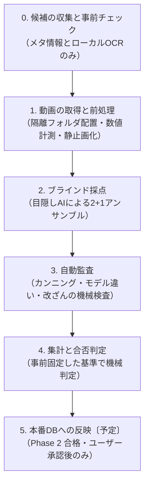

# 処理の見える化ガイド（How It Works）

このプロジェクトで「動画を集めて、目隠しで採点し、本当に信頼できるか確かめ、将来的に本番DBへ活かすまで」の全体の流れを、各段階ごとに **「何を入れるか／何をするか／何が出てくるか／ユーザーが確認・調整できる場所」** の4点で整理しています。

> **現在のステータス（2026-11-23）**：
> Phase 1 の較正テストは「本番適用不可（ケースC）」として完了し、現在は **Phase 2（事実ベース正解・ハイブリッド方式の検証）の事前準備段階** です。**本番データベース（TiDB / SQLite）への書き込みは一切行っていません。**

---

## 全体の流れ（ひと目でわかる図）

---

## 段階 0：候補の収集と事前チェック（Phase 2 で新設）

| 項目 | 内容 |
|---|---|
| **何を入れるか（入力）** | ・賞の公式ページ（一次資料）のURL ・YouTube / Vimeo の動画メタ情報（タイトル・概要欄・チャンネル情報・再生数・公開日） |
| **何をするか（処理）** | 1. 事前固定した事実ルール（`R-T2-*` 受賞 / `R-PRO-*` プロ商業 / `R-LOW-*` 明らかな低品質）に当てはまるか機械・メタ情報だけで確認する（**AI が動画の中身を見て選別しない**）。 2. 既存テスト動画（Phase 1 の83本）との重複を自動チェックする。 3. ローカル PC 上の `ffmpeg`＋`RapidOCR`（画像から文字を読み取るローカルソフト）で、画面内に受賞ロゴやテロップが写っていないか自動検査し、ヒットした動画は機械的に除外する。 |
| **何が出てくるか（出力）** | ・根拠付きデータセット JSON（各動画のルールID・証拠URL・抜粋・再生数・OCR結果を記録） ・`ocr_precheck_log.jsonl`（OCR で検出されたキーワード・時刻・信頼度・除外本数の全明細） |
| **ユーザーが確認・調整できる場所** | ・どの賞やルール（`R-T2-*` / `R-PRO-*` / `R-LOW-*`）を認めるか（[CALIBRATION_PHASE2_DESIGN.md](CALIBRATION_PHASE2_DESIGN.md)） ・OCR で除外された作品のリストを見て、誤検出がないか後から確認可能 |

---

## 段階 1：動画の取得と前処理（隔離と特徴計測）

| 項目 | 内容 |
|---|---|
| **何を入れるか（入力）** | ・凍結済みの対象動画リスト（URL とジャンル） |
| **何をするか（処理）** | 1. `yt-dlp` で動画を取得し、`ffmpeg` でメタデータ（タイトル・作成者・タグ等の埋め込み情報）を完全に削除する。 2. 元の動画IDを隠すため、ランダムな12桁記号（`blind_id`）を割り当て、隔離フォルダ（`E:\iketeru_blind_eval\<run_id>\`）へ配置する（対応表は隔離フォルダの外に別保存）。 3. `ffprobe`・`ffmpeg scdet`（カット数計測）・`ebur128`（音量 LUFS 計測）を実行し、必要に応じて静止画一覧（コンタクトシート）や高密度区間のスロー動画を自動生成する。 4. 配置した全ファイルと対応表の指紋（SHA-256）を計算し、台帳（`run_manifest.json`）に保存して git コミットでロックする。 |
| **何が出てくるか（出力）** | ・隔離フォルダ内の目隠し済み動画・コンタクトシート ・`blind_id_map.json`（対応表：隔離外） ・`run_manifest.json`（全ファイルの SHA-256 指紋と固定モデル名の台帳） ・各動画ごとの凍結済み採点指示ファイル（`specs/*.json`） |
| **ユーザーが確認・調整できる場所** | ・ハイブリッド方式の自動振り分け条件（どの条件で静止画→動画へ切り替えるか：ルール H1 / H2） ・隔離フォルダに対象以外のファイルが入っていないかの確認 |

---

## 段階 2：ブラインド採点（目隠し採点）

| 項目 | 内容 |
|---|---|
| **何を入れるか（入力）** | ・凍結済みの採点指示文（ひな型に隔離パスと長さ・カット数・音量だけを機械差し込み） ・隔離フォルダ内の目隠し済み動画またはコンタクトシート |
| **何をするか（処理）** | 1. 事前固定した AI モデル（例：`gemini-4-neon-high`）で、記憶を持たない独立したサブエージェントを起動し、1本ずつ採点する。 2. 各動画を **2回** 独立採点し、2回の点数差が **5点以上** 開いた場合のみ **3回目** を追加採点して中央値（真ん中の値）をとる（2+1 アンサンブル）。 3. 採点 AI は 100 点満点の点数・各評価項目の内訳・講評に加えて、「この作品を知っていたか（`knows_work`）」「画面に受賞ロゴがあったか」を自己申告する。 |
| **何が出てくるか（出力）** | ・`dispatch_log.jsonl`（いつ・どのサブエージェントに何を依頼したかの履歴） ・`raw_scores.jsonl`（全採点結果の生データ） ・各サブエージェントの会話ログ（`transcript.jsonl`） |
| **ユーザーが確認・調整できる場所** | ・Dev（開発用）の段階に限り、採点プロンプト（ルーブリックの文言）や境界点数（$T_{\text{award}}, T_{\text{low}}$）を調整可能（上限3回）。 ・Holdout（確認用）実行時は一切変更せず1回限りで実行する。 |

---

## 段階 3：自動監査（カンニングと改ざんの機械検査）

| 項目 | 内容 |
|---|---|
| **何を入れるか（入力）** | ・各サブエージェントの会話ログ（`transcript.jsonl`） ・事前ロックした台帳（`run_manifest.json`）、対応表（`blind_id_map.json`）、凍結指示ファイル（`specs/*.json`） |
| **何をするか（処理）** | 監査スクリプト（`scripts/audit-blind-transcript.mjs --strict --expected-model`）が全件を自動で検査する： 1. 渡した指示文が凍結ひな型と一字一句一致しているか。 2. 採点 AI が隔離フォルダ外のファイルや対応表・DB に一切触っていないか。 3. 動画や画像が実際にメディアデータとして正しく読み込まれているか。 4. 全ステップで事前固定した AI モデル（例：`gemini-4-neon-high`）が使われているか。 5. 動画ファイルや対応表の指紋（SHA-256）がテスト前から1バイトも変わっていないか。 |
| **何が出てくるか（出力）** | ・各採点ランごとの `valid / invalid` 判定結果と、違反があればその具体理由 ・使用したトークン量（コスト）の実測値 |
| **ユーザーが確認・調整できる場所** | ・監査スクリプトのテスト（`node --test`）や、別 AI による第三者チェックでいつでも再検証できる。 |

---

## 段階 4：集計と合否判定

| 項目 | 内容 |
|---|---|
| **何を入れるか（入力）** | ・監査を通過した `raw_scores.jsonl` と、事前固定した正解データセット |
| **何をするか（処理）** | 集計スクリプトが以下を自動で計算し、事前固定の合格基準に照らして機械判定（GO / 保留 / NO-GO）を出す： 1. **主判定**（ハイブリッド方式での `Tier 2` vs `プロ商業`）：ROC-AUC、感度、特異度、重大誤り率。 2. **補助判定**（`明らかな低品質` の下方分離）：透かし規則 `R-LOW-04` を含む／除くの両方で分離度を計算。 3. **参考値**：既知作品を除外した場合の成績、静止画単独・動画単独の成績、トークン削減率、95% 信頼区間（ブートストラップ 2,000 回）。 |
| **何が出てくるか（出力）** | ・`evaluation_summary.json`（全指標・混同行列・個別作品の採点一覧・機械判定結果） |
| **ユーザーが確認・調整できる場所** | ・個別作品で AI の点数と事実ラベルがズレた理由を確認し、次の改善方針（再設計するか／本番へ進むか）を判断できる。 |

---

## 段階 5：本番 DB への反映〔予定・現在は未実施〕

| 項目 | 内容 |
|---|---|
| **何を入れるか（入力）** | ・Phase 2 の確認用テスト（Holdout）で **GO（合格）** となり、さらに **ユーザーが明示的に承認した採点方式・モデル・境界点数** |
| **何をするか（処理）** | ※現時点では **一切実行しない**（本番 TiDB の 5,653 件・SQLite ともに書き込み 0 件を維持）。 将来 GO が出たあとに、対象動画に対して承認済みハイブリッド方式で分析・採点し、バックアップを取得した上で本番 DB へ段階的に反映する予定。 |
| **何が出てくるか（出力）** | ・本番 DB（TiDB）上の更新済み評価データ・検索用タグ ・（Phase 3 以降）[VISUAL_DECOMPOSITION_AND_GENERATION_VISION.md](VISUAL_DECOMPOSITION_AND_GENERATION_VISION.md) に基づく共通中間書式・編集可能プロジェクトデータ |
| **ユーザーが確認・調整できる場所** | ・本番反映を開始するかどうか（GO が出ても自動では反映せず、必ずユーザーの最終承認を待つ） ・反映件数や対象ジャンルの範囲指定 |
